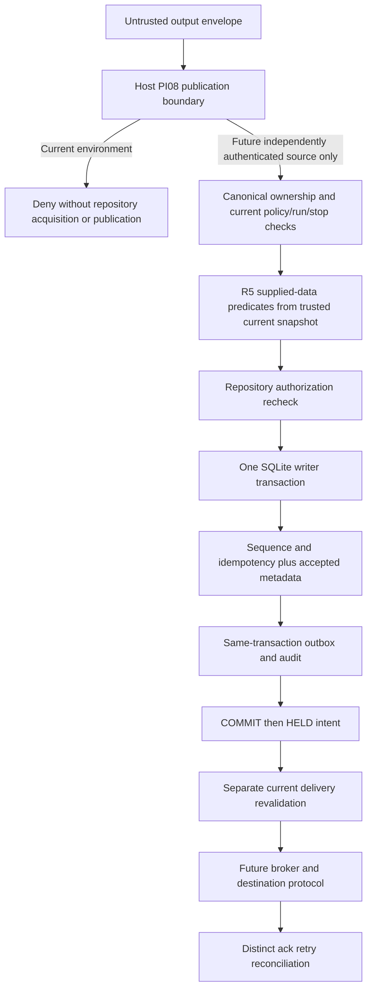

# M02-02-PI-10 — Durable Output/Outbox Architecture

## A. Executive Decision

`PI10_DURABLE_OUTPUT_OUTBOX_DESIGN_COMPLETE_IMPLEMENTATION_PENDING` + `SECURITY_STOP_PRESERVED`. **Design only.** Complete implementation-ready specification for the bounded **PI11A offline-held metadata slice**; no source, schema, database, publisher, authorization or runtime implementation performed.

Architecture gates: **23 PASS / 2 PARTIAL**. PI10-15/-16 distinguish a fully specified PI11A held-only schema/API from the future authorized production profile/proof protocol, which cannot be finalized before independent authority and destination infrastructure exist. No proposed positive behavior is implemented. Both executionAuthority and publicationAuthority remain false. A durable record, schema-consistent fixture, session ID or outbox row never authorizes delivery.

## B. Historical Checkpoint

PI09B checkpoint verified against actual source and its two reports; its 14 surface groups, actual finish output withholding and host PI08 composition remain intact. Historical 1,088 tests PASS and two scoped typechecks exit0 are **not rerun** in PI10. PI09A admission, PI05 activation-only journal, PI07 provider, R5 pure evaluator, R9 durable mock, repository schema/transaction/session/cancel/recovery source and PI01 exit matrix inspected. No historical runtime investigation repeated.

SECURITY_STOP_PRESERVED; PRODUCTION_HOST_AUTHORITY_UNAVAILABLE; PRODUCTION_PUBLICATION_ATOMICITY_NOT_VERIFIED; M02_NOT_COMPLETE; OFFICIAL_M02_EXIT_CRITERIA_INCOMPLETE. PI09B-08/-11/-12/-13/-18 remain PARTIAL, as do PI09A-18, PI02-19, PI06-08 and PI07-08 (filesystem). PI08 production trust-root/issuer-audience/clock/rotation-revocation/membership blockers remain BLOCKED/NOT_VERIFIED; its prior 17 PASS / 2 PARTIAL / 5 BLOCKED are not promoted. Four historical child-process suites NOT_RUN; historical runtime-security process-oriented suites NOT_RUN; R8-20 diagnostic evidence exception PRESERVED. External monotonic witness NOT_IMPLEMENTED; Jc NOT_OBSERVABLE and historical PID 24956 INCONCLUSIVE. Option A PENDING_OWNER_APPROVAL; D9 NOT_AUTHORIZED; evidence archival PENDING_AUTHORIZATION. Workers BLOCKED; production worker dispatcher/output broker NOT_IMPLEMENTED.

## C. Repository Baseline

Actual PI09B baseline: **532 AI Office files / 214 default Git porcelain rows**, sealed manifest SHA-256 **E52080822365125145ECDB28FFD2E9DC7AECD903462E6B00530771408B787A97** verified before design. Final inventory is independently compared with that baseline: **534 files / 216 rows, two new reports, zero existing files modified or deleted**, all old hashes and Git rows retained. Counts exclude node_modules/.git and record reparse entries without following them; Git uses default collapsed untracked-directory rows.

Protected-history recheck PASS (2026-11-10T06:30:13.3956602Z): **26,134 files / 306 roots**. **647 Hermes3D tracked files and tracked path set** unchanged. Older unavailable 2,209 files / 17 roots remain NOT_VERIFIED; no diagnostics reconstructed or archives created.

Unique design evidence: `C:\Users\USEP REZA USAMAH\AppData\Local\Temp\ai-office-pi10-1794291516944-design`. baseline.json, source-register.json plus source-register-followup.json (39 actual sources/reports with exact line anchors and hashes), scope.json, protected-integrity.json, design-review.json, final-snapshot.json, integrity-result.json and self-excluded manifest.json document custody and source comparison. The completion response gives the new manifest SHA-256/read-only post-seal result, avoiding a self-referential hash in sealed documents. Only these two new review documents were added to the repository. No source/schema/config/previous report/test/dependency modification; no DB connection/DDL/migration, credential access, application/listener/worker/provider/tool/containment/Job action or Git commit/push/reset/merge/deployment.

**PI10 application tests 0; fresh regression tests 0; typecheck NOT_RUN; SQL NOT_EXECUTED.** Historical PI09B 1,088 PASS (72+1,016) and two typecheck exit0 records remain historical, not freshly executed. Documentation/static hash checks are not application tests or SQLite syntax/transaction/runtime proof.

## D. Actual Output Architecture

Existing DurableAttemptRepository owns one project/incarnation SQLite connection and 12 tables under **USER_VERSION=9**, PROFILE=`pi05-isolated-security-stop-v1`, application_id 0x41494f46. verifySchema compares exact DDL/profile/digest/version, quick_check and foreign_key_check. configure requires DELETE journal, synchronous=EXTRA (3), foreign_keys=ON, busy_timeout=100, trusted_schema=OFF and read_uncommitted=OFF. These are source-observed settings, not freshly executed PRAGMAs.

transaction(write=true) uses BEGIN IMMEDIATE, identity check, COMMIT and rollback on error. It currently throws a generic mapped DB error and does not expose whether a failed COMMIT without an active transaction actually committed. R9 Store.attempt distinguishes this as COMMIT_OUTCOME_UNKNOWN; its fixture implementation is a reference for semantics, not an authority to import.

HOST_SQLITE initializes only under explicit trusted host configuration, then opens readOnly:true/query_only=ON; its host façade is diagnostic/read-only. RepositoryConnection's type erases source-class information. Therefore a new fixture writer must retain **private factory provenance** internally after actual claimOwnedFixtureConnection; a caller-supplied label/flag or database profile cannot enable it on a HOST_SQLITE instance.

Current security enum is UNKNOWN/BLOCKED/ACTIVE_STOP; **all deny**. There is no positive security-readiness state or clearance. Attempt runtimeRef/executionMode are fixed synthetic. PI08 authentication always denies; PI09A blocks fixture ingress; PI09B fixture finish returns empty stdout/stderr and minimal controls. No production accepted-output table, canonical publication sequence, outbox, broker, worker dispatcher, payload store or independent classifier exists.

| Surface | Actual source / symbol | Current behavior / scope |
|---|---|---|
| OP01 | src/server/runtime-security/supervisor.ts; SyntheticSecurityHarness.capture | COLLECTION_ONLY_UNCHANGED; Buffer.concat into owned Run only |
| OP02 | src/server/runtime-security/supervisor.ts; SyntheticSecurityHarness.finish ->run.resolve(ProbeResult) | TARGET_EXISTING_FIXTURE_RELEASE; Resolves result containing stdout/stderr; not external transport |
| OP03 | src/server/runtime-security/supervisor.ts; child.on(message), stopRun, cancel, close | SAFETY_CONTROL_UNCHANGED; Bounded messages and cancel IPC; owned kill only if actually running |
| OP04 | src/contracts/execution-fence.ts; evaluateOutputPublication | PURE_CONTRACT_UNCHANGED; None; no state commit or send |
| OP05 | src/contracts/testing/mock-enforcement.ts;src/contracts/testing/fake-authority-adapter.ts;src/contracts/testing/scoped-capability.ts; attemptMockPublication/prepareMockPublication/commitMockPublication; preparePublication/commitPublication; attemptScopedPublication | MOCK_ONLY_UNCHANGED; Updates fixture publications/sequence/mock single-use claims |
| OP06 | src/contracts/testing/durable-mock-transaction.ts; Store.attempt via openDurableMockTransaction.boundary.attemptDurableMockOperation | MOCK_ONLY_UNCHANGED; Writes accepted_operations and claims atomically in mock DB |
| OP07 | src/server/attempt-control/repository.ts;src/server/runtime-security/journal.ts; DurableAttemptRepository.commitTerminal/requestCancellation;FixtureAttemptJournal.transition/reconcile | SAFETY_AND_METADATA_UNCHANGED; Owned metadata transaction / journal append |
| OP08 | src/server/http.ts; reply/listenHttp route switch | NON_EXECUTION_UNCHANGED; response.writeHead/end(JSON.stringify) |
| OP09 | src/server/brain/reader.ts;src/web/components/ProjectPanels.tsx; readKnowledge/BrainPanel | NON_EXECUTION_UNCHANGED; Read existing scoped file and return JSON/display |
| OP10 | src/server/state/service.ts;src/contracts/demo.ts;src/web/workspace/controller.ts;src/web/visual/mapper.ts; ProjectStateService.snapshot/seedDemo;ShellController;mapVisualAgents | NON_EXECUTION_UNCHANGED; Owned demo DB seed/read and state rendering |
| OP11 | src/server/index.ts;scripts/dev.mjs;src/server/workspace/errors.ts; main/launcher stdout and IPC;safeFailure | NON_EXECUTION_NOT_RUN; Console and own-process IPC only if launched |
| OP12 | Asset_3D_Model/src/export/RoomExporter.ts; downloadRoomAssetPackZip/downloadRoomManifestAndAnchors/downloadRoomPreviewPng | UNRELATED_NOT_MODIFIED; Browser Blob/download |
| OP13 | docs/reviews/M02-02S11_DURABLE_ATTEMPT_CONTROL_DESIGN.md; Staging ->immutable blob ->current DB pointer (design only) | PRODUCTION_NOT_IMPLEMENTED; No production publication operation |
| OP14 | src/server/http.ts;src/server/index.ts (absence search); No production provider/tool/WS/SSE/event/output queue broker | NOT_APPLICABLE; None found |

Source register below identifies actual paths/symbol anchors; source-register.json retains exact line text/count/SHA-256. Absence/discovery claims are bounded to this source tree/import boundary, not arbitrary same-realm code or future integrations.

| Source | Actual symbols / role |
|---|---|
| S01 — src/server/attempt-control/schema.ts | USER_VERSION, PROFILE, SCHEMA_STATEMENTS, runtime_output |
| S02 — src/server/attempt-control/sqlite-format.ts | configure, verifySchema |
| S03 — src/server/attempt-control/repository.ts | class DurableAttemptRepository, transaction<, openHostOwned, activateSecurityStop, sessionSnapshot, commitTerminal, fenceForTestRecovery, requestCancellation, reconcile |
| S04 — src/server/attempt-control/connection.ts | openOwnedFixtureConnection, claimOwnedFixtureConnection |
| S05 — src/server/attempt-control/contracts.ts | ExpectedSchema, AttemptSchema, semanticDigest, databaseError |
| S06 — src/server/attempt-control/journal.ts | appendEvent, verifyHistory |
| S07 — src/server/attempt-control/host-sqlite.ts | class HostSQLiteProvider, readOnly: true, query_only, private initialize |
| S08 — src/server/attempt-control/workspace-repositories.ts | class HostWorkspaceRepositories, acquire, reopen |
| S09 — src/server/attempt-control/host-principal.ts | createHostPrincipalBoundary, authenticate, assessSessionReadiness |
| S10 — src/server/attempt-control/execution-admission.ts | createExecutionAdmissionBoundary, requireExecutionAdmission |
| S11 — src/server/attempt-control/output-publication.ts | createOutputPublicationBoundary, denyOutputPublication |
| S12 — src/server/attempt-control/execution-readiness.ts | SecurityStateSchema, evaluatePersistedReadiness |
| S13 — src/server/attempt-control/provenance.ts | evaluateProvenanceRows, GrantProvenanceSchema |
| S14 — src/server/attempt-control/host-session.ts | HostBindingSnapshot, evaluateSessionBinding, createHostIssuerForTest |
| S15 — src/server/attempt-control/security-stop.ts | activationDigest, verifySecurityStopJournal |
| S16 — src/server/attempt-control/cancellation.ts | readCancellation, assertHostAuthority, CancellationRequestSchema |
| S17 — src/server/attempt-control/recovery.ts | classifyRecovery, assertRecoveryAuthority, dispatch: |
| S18 — src/server/attempt-control/lease.ts | classifyLease, assertLeaseActive |
| S19 — src/contracts/execution-fence.ts | evaluateOutputPublication, OutputEnvelopeSchema, PublicationContextSchema |
| S20 — src/contracts/testing/durable-mock-transaction.ts | class Store, attempt\(, openDurableMockTransaction, COMMIT_OUTCOME_UNKNOWN |
| S21 — src/server/runtime-security/supervisor.ts | private capture, private async finish, denyOutputPublication, async cancel, async close |
| S22 — src/server/runtime-security/journal.ts | class FixtureAttemptJournal, transition\(, reconcile |
| S23 — src/server/host.ts | composeBackendHost, publicationBoundary |
| S24 — src/server/http.ts | routes, reply, response.end |
| S25 — src/server/index.ts | startBackend, main\( |
| S26 — src/server/state/service.ts | snapshot\(, seedDemo |
| S27 — src/server/brain/reader.ts | readKnowledge |
| S28 — docs/reviews/M02-02_PI_09B_HOST_OUTPUT_PUBLICATION_DENIAL_IMPLEMENTATION.md | ^##  |
| S29 — docs/reviews/M02-02_PI_09B_SECURITY_GATE_MATRIX.md | PI09B- |
| S30 — docs/reviews/M02-02_PI_09A_SERVER_SIDE_DENY_ONLY_ADMISSION_IMPLEMENTATION.md | ^##  |
| S31 — docs/reviews/M02-02_PI_05_SECURITY_STOP_ACTIVATION_JOURNAL_IMPLEMENTATION.md | ^##  |
| S32 — docs/reviews/M02-02_PI_07_HOST_OWNED_SQLITE_PROVIDER_IMPLEMENTATION.md | ^##  |
| S33 — docs/reviews/M02-02_PI_01_MILESTONE_EXIT_AND_SECURITY_GATE_MATRIX.md | M02 /, Missing authority |
| S34 — docs/roadmap/AI_OFFICE_ROADMAP_CURRENT_DRAFT.md | M02, Acceptance criteria, Completion gate |
| S35 — docs/specifications/MASTER_DESIGN.md | M02, PRD, DRAFT, APPROVED |
| S36 — tests/integration/durable-attempt-foundation/host-sqlite.test.ts | Current version9 assertion at112; planned legacy9 rejection and imported current version |
| S37 — tests/integration/durable-attempt-foundation/host-composition.test.ts | Corruption99 then healthy restore9 at250/252; planned USER_VERSION restore |
| S38 — tests/integration/durable-attempt-foundation/security-stop.test.ts | USER_VERSION9 assertion at260; retain all original stop checks under proposed10 |
| S39 — src/server/attempt-control/test-storage.ts | Fresh SCHEMA_SQL/USER_VERSION initialization and transaction rollback; inspect-only |

## E. Producer and Consumer Boundaries

Current path: fixed fixture probe (not started) ->bounded private capture ->owned lifecycle journal ->PI09B denial ->fixture caller receives empty text plus control result. R5 is eligibility over supplied inert metadata. R6–R9 can record mock acceptance, not production publication. HTTP returns existing scoped metadata/brain/demo, not a worker stream; no route is added.

Proposed future path, **not implemented**:



The diagram's future branch is unreachable today. PI11A supplies only **inert fixture metadata** to the same transaction shape and can never reach G/B. Raw generation, validation, authentication, authorization, metadata acceptance, intent, delivery eligibility, network attempt, transport/recipient acknowledgment and consumption are distinct. No stage implicitly authorizes the next.

## F. Canonical State Ownership

Use **DurableAttemptRepository on the same SQLite connection**; no second output database, broker-owned canonical ledger, fixture authority or global sequence counter. Existing attempt/owner epochs, session and provenance tables remain their own canonical owners. New output tables store immutable snapshots/links and sequence/status projections, not independent authentication truth.

Chosen conservative mappings, explicit design decisions:

- executionEpoch = existing attemptGeneration. This is the current canonical owner-fencing epoch, not a provider's independent counter.
- runIncarnationId = existing executionSessionId. No new run UUID issuer/table. A new run needs a new canonical execution session; restart without safe fencing cannot reuse old stream identity.
- authorityIncarnation remains the DB/project authority incarnation; it is distinct from attemptGeneration and executionSessionId.
- R5 identity maps projectId=current project, sessionId=applicationSessionId, ownerId=principalId (not process ownerId), runId=executionSessionId, workerId=authenticated producerId, taskScope=attempt.taskId. R5 policyVersion is String(canonical numeric policyVersion). This adapter is proposed only, no new production mapping exists.
- One stream key = projectId + authorityIncarnation + attemptId + attemptGeneration + executionSessionId + destinationId + channel. Multiple independently authorized producers for that same stream compete for the **same** sequence. There is no global cross-channel/destination order.
- Explicit producer-to-session and destination/channel/classification authority remain external missing dependencies; local IDs/association rows do not authenticate them.

Field ownership, source/trust, mutability/version, persistence/uniqueness and transition requirements:

| Field(s) | Owner / source | Trust | Mutability | Version | Persistence / index | Validation / lifecycle |
|---|---|---|---|---|---|---|
| outputId | Repository operation request, host-scoped UUID | Opaque untrusted id until owner verified | Immutable | recordClass, digest v1 | accepted PK, operation/outbox pair FKs | No reuse with changed digest; creation only in full transaction |
| operationId / idempotencyKey | Caller retries same stable identity; repository owns claim | Untrusted keys, never permission | Immutable | requestDigest v1 | operation PK; UNIQUE(streamId,idempotencyKey) | Exact historical replay only, conflicting identities deny |
| producerEventId / producerId | Event label caller-supplied; producer mapping must come from independent authenticated host | Unverified now; fixture-only snapshots in PI11A | Immutable accepted snapshot | principal/source revisions retained | UNIQUE(streamId,producerId,producerEventId) | Check producer→canonical execution session before future acceptance; not model self-assertion |
| projectId / authorityIncarnation | Existing connection.ref and runtime_control_meta | Storage ownership, not principal authentication | Immutable | Existing DB incarnation | stream composite FK to control_meta | No cross-project DB or restored-incarnation substitution |
| taskId / attemptId | Existing runtime_attempts; taskId derived, not duplicated | Canonical repository identity | Immutable | Existing owner epoch/history | stream composite FK to runtime_owner_epochs | Expected owner/phase/version and history must match |
| executionEpoch | Alias of existing attemptGeneration | Canonical ownership epoch, not provider-supplied epoch | Changes only via existing owner-fencing rules | No new independent counter | stream.attemptGeneration FK owner epoch | Restart requires new executionSessionId and new canonical attempt/authorized existing generation fence; no output-driven attempt bump |
| runIncarnationId | Alias of existing executionSessionId, no duplicate run UUID owner | Canonical association only; not authenticated proof | Existing execution-session identity immutable | Existing bindingRevision | stream executionSessionId FK + insertion scope trigger | R5 runId uses same session UUID; old session cannot publish into new one |
| applicationSessionId / principalId | Join existing executionSession ->application/principal rows | Canonical scoped metadata; external authentication missing | Existing source tables own updates | accepted application/principal revisions | Existing source FKs; semantic verifier joins exact scope | Never treat app/launcher/session ID as authenticated identity |
| destinationId / channel | Future authoritative destination/policy registry; current fixture labels | Unverified; current producer labels cannot authorize | Immutable stream key | Policy revision/destination authorization snapshot | stream UNIQUE identity+destination+channel | One stream per destination/channel; no arbitrary path/URL routing |
| sequence / acceptanceRevision | DurableAttemptRepository stream counter; acceptanceRevision aliases sequence | Canonical metadata order only | sequence immutable, counter CAS +1 | stream.revision=lastAccepted | UNIQUE(streamId,sequence) | Start at 1; atomic increment and metadata/outbox; no cross-stream total order |
| confidentiality / classificationSource / classificationDigest | Future independent content/classification policy; no such source today | UNVERIFIED or OFFLINE_SUPPLIED only in PI11A | Immutable snapshot; revalidation still required | Policy/evidence digest | Bounded enum, optional digest; unknown disallows external send | Caller PUBLIC flag insufficient; classification claims do not inspect payload |
| policyId / policyVersion / policyRevision | Existing policy provenance plus future authenticated policy service | Fixture provenance now, not production authority | Immutable acceptance snapshot | Numeric safe integers; R5 adapter String(policyVersion) | FK policyId; cross-check execution-session policy | Current revision must match at acceptance/delivery; never suppress readiness denials |
| grantId / authorizationRevision / provenanceSourceRevision | Existing grant provenance plus future independent grant/usage semantics | No current production grant; fixture snapshot only | Immutable acceptance snapshot | Exact revisions compared | FK grantId, optional unique usage claim | Grant record existence is not signature/authorization; single-use claim requires verified usage rule |
| claimKey | Future verified one-use authority scope hashed, not a bearer secret; optional inert fixture contract | No current single-use production protocol | Immutable once claimed | Bound to grant revision and operation | claim PK + operation UNIQUE + cyclic pair FKs | No claim consumption outside metadata/outbox transaction; omission allowed only for verified reusable rule, never caller preference |
| attemptStateVersion / securityRevision | Existing attempt projection/security-stop journal | Repository-owned current observations | Immutable acceptance snapshot | Existing CAS revisions | Strict integer columns; semantic history validation | No mutation of attempt just to accept output; current stop is checked again before delivery |
| applicationGeneration/applicationRevision/sessionBindingRevision | Existing canonical session rows | Local canonical association, not independent membership | Immutable snapshots | Existing revision/generation counters | Semantic verifier matches accepted historical snapshot to bounded canonical records | Future current delivery rejects stale session, principal or policy binding |
| payloadReference / payloadDigest / payloadByteLength | Future host-owned immutable payload store; nonexistent today | Digest alone is not classification, immutable custody or safety proof | Reference/digest immutable after acceptance | Content digest and size | PI11A payloadReference IS NULL; metadata only | No bytes/path/URL/credentials in SQL/audit; no payload storage implemented |
| createdAtMs | Trusted host clock in future; bounded supplied fixture time for PI11A | Clock authority not established in production | Immutable | Nonnegative safe integer | Explicit required timestamp, no implicit CURRENT_TIMESTAMP | Wall clock alone cannot prove lease freshness or monotonic witness |
| outboxId / state / rowRevision / lastEventId / holdReason | Same repository and DB as metadata | Durable intent/status, never a delivery permit | Guarded CAS state/reason/head changes only | rowRevision+1; one output event per revision | paired deferred FK to accepted; deferred head FK to event tuple | PI11A starts HELD and only HELD/CANCELLED allowed; no promotion API |
| leaseGeneration / owner / nonce hash / clock domain / deadlines | Future trusted delivery service and clock | Not available now | Future fenced lease CAS; zero/null throughout PI11A | Per-outbox generation, not attempt/output epoch | DDL inactive-lease CHECK in PI11A | Expired/new-host/clock-discontinuous lease does not allow blind reclaim or send |
| deliveryAttemptNumber / nextAttemptAtMs | Future broker retry policy, not producer | NOT_IMPLEMENTED | Future current-state CAS increments; zero/null in PI11A | Per-outbox attempt ordinal | future UNIQUE(outboxId,attemptNumber) | No optimistic retry after send ambiguity; no retry default grants authority |
| delivery acknowledgment | Future authenticated recipient/transport protocol | Transport !=recipient durable acceptance !=consumption | Append-only evidence, no payload | Attempt id/generation and receipt identity | future ack PK and UNIQUE(attempt,kind,recipientReceiptId) | Late ack recorded without resurrecting cancelled/revoked/held output; no exactly-once claim |
| audit event / snapshotDigest / previousDigest | Same repository transaction; new output event ledger | Consistency evidence, not signature or anti-rollback witness | Append-only | Per-outbox rowRevision chain | event PK, UNIQUE(outboxId,rowRevision), deferred projection head | No raw data, keys/nonce/paths in events; same-DB restoration remains undetectable without witness |

## G. Accepted-Output Metadata Contract

The canonical view is a join of stream, immutable accepted row, operation and outbox. Do not duplicate derived project/session/task/run/epoch values as competing owners. Historical acceptanceRevision aliases the stream sequence; outbox rowRevision is independent delivery/control metadata revision.

**PI11A recordClass=OFFLINE_CONTRACT_ONLY**, productionAccepted:false, outbox HELD. The table name runtime_accepted_outputs describes the future relationship but **fixture insertion is not authorized production acceptance**. Only a private fixture-owned repository method can record it. Production requests continue PI09B denial before acquisition and create no record.

Exact PI11A command outline (all strict, no extra keys):

```typescript
// Proposed documentation, not exported or implemented in PI10.
type HeldOutputCommand = {
  expected: Expected; expectedSecurityRevision: number;
  executionSessionId: string; expectedBindingRevision: number;
  expectedApplicationGeneration: number; expectedApplicationRevision: number;
  expectedPrincipalRevision: number; policyId: string; policyVersion: number;
  policyRevision: number; grantId: string; authorizationRevision: number;
  provenanceSourceRevision: number;
  expectedStream: { streamId: string | null; revision: number; lastAccepted: number };
  operationId: string; idempotencyKey: string; outputId: string;
  producerId: string; producerEventId: string; destinationId: string; channel: string;
  sequence: number; confidentiality: "UNVERIFIED" | "PUBLIC" | "INTERNAL" | "CONFIDENTIAL" | "RESTRICTED";
  payloadDigest: string; payloadByteLength: number;
  claim: null | { claimKey: string; grantId: string; authorizationRevision: number };
  atMs: number;
};
type HeldOutputReceipt = Readonly<{
  outcome: "OFFLINE_HELD_RECORDED" | "OFFLINE_HELD_REPLAY" | "OUTPUT_DENIED" | "COMMIT_OUTCOME_UNKNOWN";
  productionAccepted: false; publicationAuthority: false; executionAuthority: false;
  // Scoped owner-only successful metadata view may contain operation/output/outbox IDs,
  // sequence, recordClass and digest. Public denials remain fixed code/correlation only.
}>;
```

UUIDs lowercase canonical; opaque refs use existing ReferenceIdSchema; integers use SafePositive/SafeTime, no unsafe number coercion; digests lowercase SHA-256 hex. proposed hard ceilings: 128 streams/project, 4096 outputs/stream (R5 seenOutputIds ceiling), 256 audit revisions/output; bounded paged verification, no silent truncation or counter reset. payload bytes/path/URL/reference are not accepted by this fixture command.

Fixture writer prerequisites: actual private owned-fixture factory origin, current Expected nonce/owner/project/generation/version, structurally matching existing LOCAL_TEST_FIXTURE canonical session/provenance rows, no cancellation/recovery/terminal state, security UNKNOWN with no tracked stop head. BLOCKED/ACTIVE_STOP/missing/corrupt state deny even fixture new writes. UNKNOWN is permitted **only for inert held fixture metadata**, never interpreted as positive security. No new identity issuer or production skip flag. Metadata-only snapshots do not require or manufacture a real CLEARED state or a R5 positive production context.

The host itself never calls this fixture writer after a denial. Historical operation lookup may remain possible to its authorized scoped owner after cancel/stop/version advance; it returns historical metadata with false authority, not current permission.

AO mapping: AO01–07 future authenticated producer/project/session/attempt/epoch/grant/destination/classification dependencies; current production denies and downstream NOT_EVALUATED. AO08 uniqueness/digest replay; AO09 mutual accepted/outbox tuple links; AO10 transaction rollback/commit ambiguity handling; AO11 no production accepted row in current environment; AO12 intent/record never send authority. R5 fixture eligibility cannot override any of them.

## H. Payload and Confidentiality Separation

`PRODUCTION_OUTPUT_CLASSIFICATION_UNVERIFIED`. Existing R5 PUBLIC/INTERNAL/CONFIDENTIAL/RESTRICTED are metadata labels, not content inspection. PI09B withholds raw text; no authoritative classifier, encryption, key owner, immutable payload store or secret-redaction/retention service was found. Do not default public or infer authorization from a producer label.

PI11A persists **metadata only**, payloadReference NULL, synthetic digest/length, classification source UNVERIFIED/OFFLINE_SUPPLIED. No bytes, paths, recipient URLs, bearer capability, owner nonce, tokens or raw dependency errors. bindingSnapshot is a bounded strictly selected canonical metadata object, not copied arbitrary rows/payload. Even IDs/classification/destination metadata can be sensitive; owner-scoped diagnostics only, public denial never confirms existence/private identity.

Future immutable payload custody must be independently verified before acceptance: host-owned immutable blob with opaque ID, digest/length, classification evidence and explicit retention; external file/blob write is **outside SQLite atomicity**. Stage/protect first; commit reference later. Failed metadata commit can leave an orphan blob; missing/mismatched blob holds output, never substitutes bytes. Orphan GC/retention requires authenticated ownership/reachability and separately approved policy, not deletion of historical evidence. Encryption at rest/in transit and keys are NOT_VERIFIED; no encryption capability is invented. Reference existence is not safety proof.

## I. Sequence and Idempotency Model

Stream lastAccepted starts 0/revision0; first sequence1, then exactly +1 under BEGIN IMMEDIATE and CAS(streamId,revision,lastAccepted). For R5 adapter, lastAccepted=0 maps to **null**, min=1/max=4096; passing 0 would violate the existing evaluator's min check. After acceptance derive seenOutputIds from canonical rows, not caller history. New destination/channel has separate stream; no implicit fan-out/sorting. Each destination publication unit gets its own stable outputId/operation/outbox; producerEventId can be the same only across distinct streams.

operationId globally unique within the one-project DB; idempotencyKey unique per stream; outputId unique; producer event unique(streamId,producerId,producerEventId); sequence unique(streamId,sequence). Lookup all supplied stable keys before new-write CAS. A retry is historical replay **only if** operation/output/event/stream/key/digest all identify the same record. Changed identity or logical parameters conflicts; equal payload digest alone is not deduplication. Keep original operation/key after restart; do not create a fresh UUID to work around ambiguous commit.

Digest v1 uses existing semanticDigest/fixed-order JSON arrays over canonical stream identity, outputId, producer/event, destination/channel, requested next sequence, classification/source/evidence digest, payload digest/length/null reference, principal/session/policy/grant/source snapshot identity/revisions and optional claim key. operationId/key equality is checked separately. Exclude host-generated outbox/event IDs, correlation, retry time, mutable current CAS expectation and transport retry ordinal. bindingSnapshot/digest captures the originally observed attempt/security/session revisions; exact replay checks original logical command, not new current Expected revisions, and remains a historical receipt only.

Exact PI11A logical request digest order (using existing semanticDigest, which prefixes the outer version1 array):

```typescript
semanticDigest([
  "OFFLINE_HELD_OUTPUT_V1",
  projectId, authorityIncarnation, attemptId, attemptGeneration, executionSessionId,
  destinationId, channel, outputId, producerId, producerEventId, sequence,
  confidentiality, classificationSource, null, // classificationDigest is NULL in PI11A
  payloadDigest, payloadByteLength, null,       // payloadReference is NULL
  principalId, expectedPrincipalRevision, applicationSessionId,
  expectedApplicationGeneration, expectedApplicationRevision, expectedBindingRevision,
  policyId, policyVersion, policyRevision, grantId, authorizationRevision,
  provenanceSourceRevision, claimKeyOrNull
]);
```

classificationSource is forced internally to UNVERIFIED for UNVERIFIED classification, otherwise OFFLINE_SUPPLIED; it is not caller-settable. classificationDigest is NULL because there is no independent classifier. principalId/applicationSessionId derive from the canonical execution-session association, not caller claims. claim grant/revision must match the accepted grant/revision. For historical replay recompute against the **original validated persisted identity/snapshot** and unchanged logical command fields, not newly observed mutable rows; authorization of the lookup is separate. Exclude expected.stateVersion, expectedSecurityRevision, expectedStream CAS values, owner nonce, snapshot issued/expires/atMs and retry times from logical digest. They remain required on new-write validation and immutable observed acceptance audit. This prevents legitimate lost-receipt retry after revision advance from creating a different operation or false digest conflict. Replayed receipt still does not authorize current delivery.

Binding digest uses semanticDigest of the exact HostBindingSnapshot fields in the order listed in R.4, followed by producerId and channel. snapshotDigest uses semanticDigest(["OUTPUT_PROJECTION_V1",outboxId,outputId,state,rowRevision,holdReason,leaseGeneration,leaseOwnerHostId,leaseNonceHash,leaseClockDomainId,leaseDeadlineWallMs,leaseDeadlineMonoMs,deliveryAttemptNumber,nextAttemptAtMs,createdAtMs,updatedAtMs,bindingDigest,requestDigest]). Nullable values remain JSON null, not omitted. No circular event-head ID is hashed into the projection; eventDigest binds its previous head and current snapshot separately. Invalid digest/row mismatch fails closed; unkeyed digest is consistency evidence only.

SQ01 uniqueness; SQ02 epoch from existing attemptGeneration; SQ03 session-run identity; SQ04 rollback counter/claim together; SQ05 committed operation lookup; SQ06 reject gap/order/conflict rather than reorder confidential data; SQ07 cancellation blocks new eligibility but never rewinds history; SQ08 reopen verifies count/max/contiguous sequence/revision and linked operations. No production sequence atomicity claimed in PI10.

## J. Durable Outbox Lifecycle

One outbox per accepted row via mutual deferred pair FKs; no partial logical acceptance. Default HELD, never PENDING merely because metadata committed. PI11A DDL hard-checks HELD/CANCELLED only with leaseGeneration/deliveryAttemptNumber0 and every delivery field NULL; there is no dispatcher or release API. SQL knowledge/row possession cannot authenticate anyone.

Full **future design-only** transition guards:

| From | To | Required current guard | Limit |
|---|---|---|---|
| HELD | PENDING | Future independent delivery service authenticates; all current scope/run/stop/policy/classification/payload/clock checks pass; explicit delivery policy. NOT available under current state enum. | No send, lease or acceptance promotion implied |
| PENDING / due RETRYABLE_FAILURE | CLAIMED | CAS row rev/state; current auth and retry bound; new lease generation/owner/nonce hash/domain and deadlines; append event. | Lease ownership only, no send permit |
| CLAIMED | DELIVERING | Recheck every current dependency including cancellationPayload/stop; live lease and expiry; persist immutable send intent/attempt ordinal/event, then COMMIT. | Only then future broker may attempt delivery; no network in transaction |
| DELIVERING | DELIVERED | Authenticated recipient durable acceptance for exact dest operation/outbox/digest; CAS original current attempt/lease; no current hold/cancel. | Transport ack alone insufficient; consumption separately recorded |
| CLAIMED / DELIVERING | RETRYABLE_FAILURE | Only verified definitive no-send/recipient-not-accepted outcome and valid destination protocol/policy allows safe same-key retry. | No automatic optimistic retry |
| CLAIMED / DELIVERING | RECONCILIATION_REQUIRED | Timeout/unknown send/ack, lost continuity, conflicting evidence, expired/replaced lease or storage uncertainty. | No blind reclaim/resend |
| HELD / PENDING / CLAIMED / RETRYABLE_FAILURE | CANCELLED or HELD | Current cancellation/revocation/stop/session/terminal/confidentiality/owner failure; typed event and CAS. | No rollback of delivered bytes; in-flight delivery separately ambiguous |
| Any undelivered state | PERMANENT_FAILURE or HELD | Definitive permanent rejection/policy exhaustion; no caller error text. | No delivery retry unless separate explicitly authorized new operation |
| DELIVERED / CANCELLED / PERMANENT_FAILURE | Same terminal state only (future late evidence) | Append authentic late observation without reauthorizing or replacing metadata. Exact duplicate ack is no-op; conflicting ack quarantines. | PI11A CANCELLED does not mutate; late delivery evidence tables unavailable |
| PI11A HELD | HELD / CANCELLED only | Private owned fixture mutation, current row CAS, bounded reason, same-db event; DDL blocks all delivery fields/states. | These are inert metadata controls, not delivery |

OB01–03 same-db mutual links/rollback; OB04 intent not permit; OB05 revalidation at claim and send; OB06–08 current revoke/cancel/stop; OB09 bounded verified lease plus continuity; OB10 stable logical operation across claims; OB11 DB dedup distinct from recipient dedup; OB12 no exactly-once external claim. No current transition enters a deliverable state.

## K. Atomic Transaction Boundary

**Feasible for local metadata on one owned fixture SQLite connection; not available as a production write path.** No ATTACH/second DB, public nested transaction, await, network/provider call, arbitrary callback or external payload IO inside body. Current host connection read-only stays read-only.

Future authorized branch, unreachable today: authenticate independently before privileged acquisition, verify actual producer/membership/classifier/storage/destination source, capture bounded opaque proof tied to operation and expiry; then one writer transaction revalidates that proof/current revisions. Existing evaluatePersistedReadiness is an admission-only, always-denied contract expecting APPROVAL_GRANTED: **do not treat it as a positive RUNNING-output gate or ignore its denial reasons**. Future publication authority/security model needs separate approved integration; no positive state/clearance is invented here. R5 RUNNING/cancel/terminal predicate may use trusted current rows only after those prerequisites.

PI11A transaction outline (fixture metadata, never authorized production branch):

1. Reject non-fixture private constructor origin, malformed/accessor/oversized inputs or missing owner before write; no caller source flag/config.
2. BEGIN IMMEDIATE on existing connection, verify exact v10 proposed profile/DDL/integrity, original attempt/security journals and output consistency. Verify connection.ref scope.
3. Resolve exact historical operation replay/conflicts under owned scope; replay returns stored false-authority receipt without counter/event changes. No new authority follows a lookup.
4. For new metadata, validate Expected and actual local fixture session/provenance relationships, expected securityRevision, UNKNOWN/no tracked head, no cancellationPayload/terminal/recovery, current owner and existing lease rules where applicable; check canonical binding snapshot and size/capacity.
5. Find/create canonical stream by immutable key. If expectedStream.streamId=null require no existing stream and expected revision/lastAccepted0. Otherwise exact ID/revision/counter required. Reject sequence !=last+1.
6. Under same transaction conditionally CAS stream counter/revision; insert operation and optional inert claim. Null claim is not a production reusable-grant assertion. A future one-use/reusable rule must come from verified grant protocol, unavailable now.
7. Insert immutable fixture accepted row with selected bindingSnapshot/digest; insert outbox HELD and initial OFFLINE_HELD_RECORDED event/head. Deferred tuple FKs enforce operation/claim/output/outbox/head coupling at COMMIT.
8. Validate every relationship, sequence projection, claim grant/revision, snapshot/digest/event and bounded history before COMMIT. Do not mutate attempt phase/version or security state merely to record output; output uses its own sequence/audit in the same DB.
9. COMMIT, then return only the stored metadata receipt. A controlled lost-ack failure after COMMIT must not erase the operation.
10. Never auto retry a write body. Caller resolves outcome by owned reopen/lookup, then fresh checks if no operation proven committed.

Existing transaction engine extension: add **private internal phase observation**, preserving legacy call signature/error behavior by default. Record begin/body/commitAttempted/commitReturned/rollbackReturned/transactionActive. The output adapter classifies proven rollback, committed result and COMMIT_OUTCOME_UNKNOWN; it does not create a second transaction manager/connection. No user callback/hook accepted. Generic DATABASE_FAILURE alone is not proof of rollback. On COMMIT error without a proven active rollback or on rollback failure, close/quarantine ownership, return unknown, and require same-operation lookup; no success or new operation until resolved. Future PI11A regression tests must cover unchanged legacy errors as well as output adapter.

| Failure | Required result |
|---|---|
| Claim succeeds, accepted insert fails | Proven rollback removes claim/op/counter together; no capability consumption remains |
| Metadata succeeds, outbox/event fails | Roll back all rows; mutual links prevent partial COMMIT |
| COMMIT reports failure with proven rollback | No receipt, no rows/seq; explicit caller retry revalidates |
| COMMIT outcome ambiguous / rollback fails | Quarantine, COMMIT_OUTCOME_UNKNOWN; reopen/lookup, no blind repeat |
| COMMIT succeeds, receipt lost | Original operation persists, exact key/digest lookup returns historical receipt |
| Same key changed parameters | OUTPUT_IDEMPOTENCY_CONFLICT, zero mutation |
| Stop/cancellation writer wins before transaction | New output rejects; no stale snapshot acceptance |
| Stop/cancellation attempts during writer lock | Serialized in same DB; revalidation before send still mandatory after commit |
| Corrupt schema/FK/head/source/history | Fail closed, no migration/repair/backfill |
| READONLY / BUSY | Known precommit failure rolls back; bounded 100ms current acquisition; no automatic command-body retry |
| External auth revokes during local transaction | SQL cannot lock external authority; bounded fresh proof/protocol needed, otherwise deny; no distributed atomicity claim |

## L. Delivery-Time Revalidation

A future approved broker must independently authenticate **service and subject/producer**, resolve current project/application/execution session and membership, compare run/attemptGeneration, destination/channel/confidentiality/content/custody, current attempt cancellationPayload/terminal/recovery, sticky security-stop/journal, principal/policy/grant/source revisions/expiry and exact outbox lease ownership/generation/nonce hash/host/clock deadlines. Recheck at claim and again immediately before recording DELIVERING/send intent. Required source unavailable ->HELD/reconciliation before any send. Current PI08 and security enums therefore always deny.

Do not hold a SQLite transaction across external delivery. Revocation after last local check races with external send; database locks cannot retract bytes or atomically consult a remote service. A compatible recipient protocol may enforce current fencing/destination idempotency, but none exists here. Until supported destination/service identity/revocation policy and owner-approved semantics are established, broker remains NOT_IMPLEMENTED. No arbitrary HTTP/WS/email destination fallback.

## M. Cancellation and Revocation

Check cancellationPayload even if phase still APPROVAL_GRANTED (existing noLaunch semantics). Terminal ordinary output, recovery/uncertain owner, stale canonical session/epoch or revoked grant/policy/membership cannot become deliverable. Eager batch hold/cancel can help future scheduling but is **not the security gate**; every claim/send rechecks current canonical state. No sequence rewind, accepted snapshot rewrite or idempotency release after cancel.

Already sent output may be irreversible. Cancel during DELIVERING ->record uncertainty/hold, reconcile authentic recipient evidence; do not mark unsent just because local DB changed. A late ack records evidence without resurrecting CANCELLED/held/revoked output or changing its payload/destination. Minimal cancellation/termination controls remain internal typed metadata and do not pass raw model output under a control label.

## N. SECURITY_STOP Enforcement

Reuse existing securityRevision and append-only stop journal; no second stop owner, allow flag, relaxation, CLEARED enum or activation/clearance endpoint. Every current security state denies production output. PI11A fixture recording under UNKNOWN is explicitly non-authorizing test metadata; BLOCKED/ACTIVE_STOP/missing/corrupt new-write deny. Existing activation/control operations remain independent and source unchanged in PI10.

Future production branch cannot be activated by changing outbox state or recordClass: actual independent authority and a separately reviewed positive readiness model are missing. PI11A DDL has no positive record class and no deliverable state. Sticky stop cannot be bypassed by replaying a previously accepted row, lease or old session.

## O. Delivery Acknowledgment and Retry

Five distinct facts: (1) durable intent, (2) immutable local send attempt, (3) transport accepted, (4) authenticated recipient durable acceptance, (5) recipient consumption. Only a protocol-verified recipient acceptance may support future DELIVERED; transport ACK alone does not. Consumption, if evidenced, is a separate appended kind, not assumed. Raw response/body/token never persisted as audit; retain bounded opaque receipt ID and evidence digest.

Stable destination logical operation key is outboxId bound to destination/scope/payload digest; retries use same key, new local attempt ordinal and new live lease generation. Unique(outbox,attemptNumber) and unique(outbox,leaseGeneration) forbid multiple send intents in one lease. Destination must support evidenced durable dedup/status with retention exceeding the entire approved retry horizon. Otherwise ambiguous delivery **cannot be automatically retried**.

Current retry limit effectively zero: no broker/policy/service authority. Future retry requires explicit authenticated maxAttempts/maxElapsed/backoff/deadline policy with bounded safe integers and trusted clock, never a permissive default. Definitive no-send failure can become RETRYABLE_FAILURE; timeout/unknown send/ACK ->RECONCILIATION_REQUIRED. Do not claim exactly-once external effects or actual recipient consumption.

## P. Crash and Restart Recovery

| Scenario | Required recovery | Prohibited inference |
|---|---|---|
| Before acceptance COMMIT | Proven rollback ->no rows/claim/sequence; unclear COMMIT ->quarantine+lookup | No receipt =not proof of rollback |
| After COMMIT before acceptance receipt | Lookup same operation/idempotency+digest under owned scope; return historical receipt false authority | Do not create different operation/output/sequence |
| Before delivery claim | HELD stays HELD, future PENDING requires new current authorization | Never start a dispatcher from existence of row |
| After CLAIMED before send | Owner restart/unknown clock ->HELD/reconciliation with event; no blind lease steal | Absence of send receipt doesn't prove absence of send |
| After send before ack | RECONCILIATION_REQUIRED, query trusted recipient by stable outbox key+digest if protocol available | Without recipient dedup/status proof no automatic resend |
| Ack received before local update | Persist/replay authentic receipt after reopening; local ack commit ambiguity ->lookup | Transport receipt not recipient consumption |
| Restart expired delivery lease | New host/domain invalidates prior lease; retain generation history and unknown attempts | Wall expiry alone not proof prior worker stopped/no delivery |
| Revocation while pending | Current grant/policy/session/auth source check holds/cancels undelivered output | If send already crossed boundary, record uncertainty; no retraction claim |
| Cancellation while pending | Check cancellationPayload not just phase; cancel pending rows, don't rewind sequence | Safety ack/journal remain usable, no ordinary payload in control |
| Older consistent DB restoration | Independent monotonic witness unavailable ->freshness NOT_VERIFIED and delivery remains held | Schema/hash/chains/UUIDs all can be restored together; no DB-only anti-rollback proof |

Reopen validates exact schema/profile/meta, existing histories and all output operation/claim/accepted/outbox/event/stream relationships. No repair/backfill/deletion. An immutable bindingSnapshot validates its **recorded historical** fields/digest, not equality with later mutable current status/revision. Legitimate policy/session/security/attempt changes make an output stale-for-delivery, not corrupt historical evidence. Revisions cannot move backwards without hold/integrity review; full consistent DB restore can still evade DB-only checks. Verify original snapshot against retained immutable IDs/epochs and its event digest; absent independent signatures/history do not prove production authenticity.

Existing RecoveryAuthority.dispatch=CLOSED/retryAuthorized:false and synthetic host context are not repurposed as broker credentials. Clock-domain/host changes invalidate lease continuity; wall-clock expiration alone is insufficient. External monotonic witness NOT_IMPLEMENTED; restore-freshness NOT_VERIFIED, delivery remains held.

## Q. External Side-Effect Guarantees and Limits

Local metadata acceptance/op/claim/sequence/outbox/audit can share one SQLite transaction under its configured durability model. This **does not** cover independent databases, payload filesystem/blob IO, providers, network send, recipient storage/ack or consumption. Unkeyed digests/FKs/triggers are consistency checks against supported mutation paths, not protection from privileged schema removal, coherent DB forgery/restoration, hostile same-realm JS or OS compromise.

`PRODUCTION_PUBLICATION_ATOMICITY_NOT_VERIFIED`; `PRODUCTION_OUTPUT_CLASSIFICATION_UNVERIFIED`. No production task output, Windows containment/MXC, service identity, entitlement/billing, filesystem race-free guarantee or historical incident disposition is established.

## R. Exact Proposed SQLite Schema

**DDL below is documentation, NOT_EXECUTED.** Current USER_VERSION9 is verified from schema.ts; proposed fresh PI11A version10 is the next additive format, not an applied migration/reserved production format. Recheck version before PI11A in case of intervening work. Proposed PROFILE=`pi11a-held-output-metadata-v1`, application_id unchanged; schemaRevision1 stays the control-meta row format. Existing 12 tables/triggers/security-state semantics remain; add the following **six**. SCHEMA_STATEMENTS/SCHEMA_SQL/SCHEMA_DIGEST must be regenerated together and exact validator updated through existing imports.

No in-place upgrade/backfill. Fresh disposable CREATE_NEW only; existing v9 reopen rejects without byte mutation. Host provider remains read-only and no writable production factory is added. The structural offline checks are intentional hard stops. Future authorized delivery requires another reviewed source/security/profile evolution; do not remove them as a convenience flag.

Every omitted DEFAULT means **no default**, explicit value required; omitted NULL/NOT NULL means nullable only where explicitly described by DDL. PK IDs are also NOT NULL explicitly. UUID/ref/digest normalization and all numeric safe bounds enforced by strict method schemas; SQL validates structural links/bounds too. All FKs and initial audit partners must exist at COMMIT. Mutable cross-field/revision/snapshot invariants beyond DDL are specified in the verifier list below.

```sql
CREATE TABLE runtime_output_streams (
  streamId TEXT PRIMARY KEY NOT NULL,
  projectId TEXT NOT NULL,
  authorityIncarnation TEXT NOT NULL,
  attemptId TEXT NOT NULL,
  attemptGeneration INTEGER NOT NULL CHECK(attemptGeneration BETWEEN 1 AND 9007199254740991),
  executionSessionId TEXT NOT NULL,
  destinationId TEXT NOT NULL CHECK(length(destinationId) BETWEEN 1 AND 128),
  channel TEXT NOT NULL CHECK(length(channel) BETWEEN 1 AND 128),
  lastAccepted INTEGER NOT NULL DEFAULT 0 CHECK(lastAccepted BETWEEN 0 AND 9007199254740991),
  revision INTEGER NOT NULL DEFAULT 0 CHECK(revision BETWEEN 0 AND 9007199254740991),
  createdAtMs INTEGER NOT NULL CHECK(createdAtMs BETWEEN 0 AND 9007199254740991),
  UNIQUE(projectId,authorityIncarnation,attemptId,attemptGeneration,executionSessionId,destinationId,channel),
  FOREIGN KEY(projectId,authorityIncarnation) REFERENCES runtime_control_meta(projectId,authorityIncarnation),
  FOREIGN KEY(projectId,attemptId,attemptGeneration) REFERENCES runtime_owner_epochs(projectId,attemptId,attemptGeneration),
  FOREIGN KEY(executionSessionId) REFERENCES runtime_execution_sessions(executionSessionId),
  CHECK(revision=lastAccepted)
) STRICT;

CREATE TABLE runtime_output_operations (
  operationId TEXT PRIMARY KEY NOT NULL,
  streamId TEXT NOT NULL,
  idempotencyKey TEXT NOT NULL CHECK(length(idempotencyKey) BETWEEN 1 AND 128),
  requestDigest TEXT NOT NULL CHECK(length(requestDigest)=64 AND requestDigest NOT GLOB '*[^0-9a-f]*'),
  outputId TEXT NOT NULL UNIQUE,
  claimKey TEXT UNIQUE,
  createdAtMs INTEGER NOT NULL CHECK(createdAtMs BETWEEN 0 AND 9007199254740991),
  UNIQUE(streamId,idempotencyKey),
  UNIQUE(operationId,outputId),
  UNIQUE(operationId,outputId,streamId),
  UNIQUE(operationId,claimKey),
  FOREIGN KEY(streamId) REFERENCES runtime_output_streams(streamId),
  FOREIGN KEY(outputId,operationId) REFERENCES runtime_accepted_outputs(outputId,operationId) DEFERRABLE INITIALLY DEFERRED,
  FOREIGN KEY(operationId,claimKey) REFERENCES runtime_output_grant_claims(operationId,claimKey) DEFERRABLE INITIALLY DEFERRED
) STRICT;

CREATE TABLE runtime_output_grant_claims (
  claimKey TEXT PRIMARY KEY NOT NULL CHECK(length(claimKey)=64 AND claimKey NOT GLOB '*[^0-9a-f]*'),
  operationId TEXT NOT NULL UNIQUE,
  grantId TEXT NOT NULL,
  authorizationRevision INTEGER NOT NULL CHECK(authorizationRevision BETWEEN 1 AND 9007199254740991),
  claimedAtMs INTEGER NOT NULL CHECK(claimedAtMs BETWEEN 0 AND 9007199254740991),
  UNIQUE(operationId,claimKey),
  FOREIGN KEY(grantId) REFERENCES runtime_grant_provenance(grantId),
  FOREIGN KEY(operationId,claimKey) REFERENCES runtime_output_operations(operationId,claimKey) DEFERRABLE INITIALLY DEFERRED
) STRICT;

CREATE TABLE runtime_accepted_outputs (
  outputId TEXT PRIMARY KEY NOT NULL,
  operationId TEXT NOT NULL UNIQUE,
  outboxId TEXT NOT NULL UNIQUE,
  streamId TEXT NOT NULL,
  sequence INTEGER NOT NULL CHECK(sequence BETWEEN 1 AND 9007199254740991),
  producerId TEXT NOT NULL CHECK(length(producerId) BETWEEN 1 AND 128),
  producerEventId TEXT NOT NULL CHECK(length(producerEventId) BETWEEN 1 AND 128),
  recordClass TEXT NOT NULL DEFAULT 'OFFLINE_CONTRACT_ONLY' CHECK(recordClass='OFFLINE_CONTRACT_ONLY'),
  confidentiality TEXT NOT NULL DEFAULT 'UNVERIFIED' CHECK(confidentiality IN ('UNVERIFIED','PUBLIC','INTERNAL','CONFIDENTIAL','RESTRICTED')),
  classificationSource TEXT NOT NULL DEFAULT 'UNVERIFIED' CHECK(classificationSource IN ('UNVERIFIED','OFFLINE_SUPPLIED')),
  classificationDigest TEXT CHECK(classificationDigest IS NULL OR (length(classificationDigest)=64 AND classificationDigest NOT GLOB '*[^0-9a-f]*')),
  bindingSnapshot TEXT NOT NULL CHECK(json_valid(bindingSnapshot) AND length(CAST(bindingSnapshot AS BLOB))<=16384),
  bindingDigest TEXT NOT NULL CHECK(length(bindingDigest)=64 AND bindingDigest NOT GLOB '*[^0-9a-f]*'),
  payloadReference TEXT CHECK(payloadReference IS NULL),
  payloadDigest TEXT NOT NULL CHECK(length(payloadDigest)=64 AND payloadDigest NOT GLOB '*[^0-9a-f]*'),
  payloadByteLength INTEGER NOT NULL DEFAULT 0 CHECK(payloadByteLength BETWEEN 0 AND 9007199254740991),
  attemptStateVersion INTEGER NOT NULL CHECK(attemptStateVersion BETWEEN 1 AND 9007199254740991),
  securityRevision INTEGER NOT NULL CHECK(securityRevision BETWEEN 1 AND 9007199254740991),
  principalRevision INTEGER NOT NULL CHECK(principalRevision BETWEEN 1 AND 9007199254740991),
  applicationGeneration INTEGER NOT NULL CHECK(applicationGeneration BETWEEN 1 AND 9007199254740991),
  applicationRevision INTEGER NOT NULL CHECK(applicationRevision BETWEEN 1 AND 9007199254740991),
  sessionBindingRevision INTEGER NOT NULL CHECK(sessionBindingRevision BETWEEN 1 AND 9007199254740991),
  policyId TEXT NOT NULL,
  policyVersion INTEGER NOT NULL CHECK(policyVersion BETWEEN 1 AND 9007199254740991),
  policyRevision INTEGER NOT NULL CHECK(policyRevision BETWEEN 1 AND 9007199254740991),
  grantId TEXT NOT NULL,
  authorizationRevision INTEGER NOT NULL CHECK(authorizationRevision BETWEEN 1 AND 9007199254740991),
  provenanceSourceRevision INTEGER NOT NULL CHECK(provenanceSourceRevision BETWEEN 1 AND 9007199254740991),
  createdAtMs INTEGER NOT NULL CHECK(createdAtMs BETWEEN 0 AND 9007199254740991),
  UNIQUE(outputId,operationId),
  UNIQUE(outputId,outboxId),
  UNIQUE(streamId,sequence),
  UNIQUE(streamId,producerId,producerEventId),
  FOREIGN KEY(streamId) REFERENCES runtime_output_streams(streamId),
  FOREIGN KEY(policyId) REFERENCES runtime_policy_provenance(policyId),
  FOREIGN KEY(grantId) REFERENCES runtime_grant_provenance(grantId),
  FOREIGN KEY(operationId,outputId,streamId) REFERENCES runtime_output_operations(operationId,outputId,streamId) DEFERRABLE INITIALLY DEFERRED,
  FOREIGN KEY(outboxId,outputId) REFERENCES runtime_output_outbox(outboxId,outputId) DEFERRABLE INITIALLY DEFERRED
) STRICT;

CREATE TABLE runtime_output_outbox (
  outboxId TEXT PRIMARY KEY NOT NULL,
  outputId TEXT NOT NULL UNIQUE,
  state TEXT NOT NULL DEFAULT 'HELD' CHECK(state IN ('HELD','PENDING','CLAIMED','DELIVERING','DELIVERED','RETRYABLE_FAILURE','PERMANENT_FAILURE','CANCELLED','RECONCILIATION_REQUIRED')),
  rowRevision INTEGER NOT NULL DEFAULT 1 CHECK(rowRevision BETWEEN 1 AND 9007199254740991),
  lastEventId TEXT NOT NULL,
  holdReason TEXT NOT NULL DEFAULT 'AUTHORITY_UNAVAILABLE' CHECK(holdReason IN ('AUTHORITY_UNAVAILABLE','CLASSIFICATION_UNVERIFIED','CANCELLED','REVOKED','SECURITY_STOP','TERMINAL','STORAGE_UNVERIFIED','RECONCILIATION_REQUIRED')),
  leaseGeneration INTEGER NOT NULL DEFAULT 0 CHECK(leaseGeneration BETWEEN 0 AND 9007199254740991),
  leaseOwnerHostId TEXT,
  leaseNonceHash TEXT CHECK(leaseNonceHash IS NULL OR (length(leaseNonceHash)=64 AND leaseNonceHash NOT GLOB '*[^0-9a-f]*')),
  leaseClockDomainId TEXT,
  leaseDeadlineWallMs INTEGER CHECK(leaseDeadlineWallMs IS NULL OR leaseDeadlineWallMs BETWEEN 0 AND 9007199254740991),
  leaseDeadlineMonoMs INTEGER CHECK(leaseDeadlineMonoMs IS NULL OR leaseDeadlineMonoMs BETWEEN 0 AND 9007199254740991),
  deliveryAttemptNumber INTEGER NOT NULL DEFAULT 0 CHECK(deliveryAttemptNumber BETWEEN 0 AND 9007199254740991),
  nextAttemptAtMs INTEGER CHECK(nextAttemptAtMs IS NULL OR nextAttemptAtMs BETWEEN 0 AND 9007199254740991),
  createdAtMs INTEGER NOT NULL CHECK(createdAtMs BETWEEN 0 AND 9007199254740991),
  updatedAtMs INTEGER NOT NULL CHECK(updatedAtMs BETWEEN 0 AND 9007199254740991),
  UNIQUE(outboxId,outputId),
  FOREIGN KEY(outputId,outboxId) REFERENCES runtime_accepted_outputs(outputId,outboxId) DEFERRABLE INITIALLY DEFERRED,
  FOREIGN KEY(lastEventId,outboxId,rowRevision) REFERENCES runtime_output_events(eventId,outboxId,rowRevision) DEFERRABLE INITIALLY DEFERRED,
  CHECK(updatedAtMs>=createdAtMs),
  CHECK(state IN ('HELD','CANCELLED') AND leaseGeneration=0 AND deliveryAttemptNumber=0 AND leaseOwnerHostId IS NULL AND leaseNonceHash IS NULL AND leaseClockDomainId IS NULL AND leaseDeadlineWallMs IS NULL AND leaseDeadlineMonoMs IS NULL AND nextAttemptAtMs IS NULL)
) STRICT;

CREATE TABLE runtime_output_events (
  eventId TEXT PRIMARY KEY NOT NULL,
  outboxId TEXT NOT NULL,
  rowRevision INTEGER NOT NULL CHECK(rowRevision BETWEEN 1 AND 9007199254740991),
  eventType TEXT NOT NULL CHECK(eventType IN ('OFFLINE_HELD_RECORDED','OFFLINE_HELD_RETAINED','OFFLINE_CANCELLED')),
  priorState TEXT CHECK(priorState IS NULL OR priorState IN ('HELD','PENDING','CLAIMED','DELIVERING','DELIVERED','RETRYABLE_FAILURE','PERMANENT_FAILURE','CANCELLED','RECONCILIATION_REQUIRED')),
  newState TEXT NOT NULL CHECK(newState IN ('HELD','PENDING','CLAIMED','DELIVERING','DELIVERED','RETRYABLE_FAILURE','PERMANENT_FAILURE','CANCELLED','RECONCILIATION_REQUIRED')),
  reasonCode TEXT NOT NULL CHECK(reasonCode IN ('AUTHORITY_UNAVAILABLE','CLASSIFICATION_UNVERIFIED','CANCELLED','REVOKED','SECURITY_STOP','TERMINAL','STORAGE_UNVERIFIED','RECONCILIATION_REQUIRED')),
  atMs INTEGER NOT NULL CHECK(atMs BETWEEN 0 AND 9007199254740991),
  snapshotDigest TEXT NOT NULL CHECK(length(snapshotDigest)=64 AND snapshotDigest NOT GLOB '*[^0-9a-f]*'),
  previousEventId TEXT,
  previousDigest TEXT CHECK(previousDigest IS NULL OR (length(previousDigest)=64 AND previousDigest NOT GLOB '*[^0-9a-f]*')),
  eventDigest TEXT NOT NULL CHECK(length(eventDigest)=64 AND eventDigest NOT GLOB '*[^0-9a-f]*'),
  UNIQUE(outboxId,rowRevision),
  UNIQUE(eventId,outboxId,rowRevision),
  FOREIGN KEY(outboxId) REFERENCES runtime_output_outbox(outboxId),
  FOREIGN KEY(previousEventId) REFERENCES runtime_output_events(eventId),
  CHECK((rowRevision=1 AND priorState IS NULL AND previousEventId IS NULL AND previousDigest IS NULL AND eventType='OFFLINE_HELD_RECORDED' AND newState='HELD') OR (rowRevision>1 AND priorState='HELD' AND previousEventId IS NOT NULL AND previousDigest IS NOT NULL AND ((eventType='OFFLINE_HELD_RETAINED' AND newState='HELD') OR (eventType='OFFLINE_CANCELLED' AND newState='CANCELLED'))))
) STRICT;

CREATE INDEX runtime_output_pending_order ON runtime_output_outbox(state,nextAttemptAtMs,outboxId);
CREATE INDEX runtime_output_attempt_stream ON runtime_output_streams(projectId,attemptId,attemptGeneration);
CREATE INDEX runtime_output_event_chain ON runtime_output_events(outboxId,rowRevision);

CREATE TRIGGER runtime_output_operations_no_update BEFORE UPDATE ON runtime_output_operations
BEGIN SELECT RAISE(ABORT,'retained output metadata'); END;
CREATE TRIGGER runtime_output_operations_no_delete BEFORE DELETE ON runtime_output_operations
BEGIN SELECT RAISE(ABORT,'retained output metadata'); END;

CREATE TRIGGER runtime_output_grant_claims_no_update BEFORE UPDATE ON runtime_output_grant_claims
BEGIN SELECT RAISE(ABORT,'retained output metadata'); END;
CREATE TRIGGER runtime_output_grant_claims_no_delete BEFORE DELETE ON runtime_output_grant_claims
BEGIN SELECT RAISE(ABORT,'retained output metadata'); END;

CREATE TRIGGER runtime_accepted_outputs_no_update BEFORE UPDATE ON runtime_accepted_outputs
BEGIN SELECT RAISE(ABORT,'retained output metadata'); END;
CREATE TRIGGER runtime_accepted_outputs_no_delete BEFORE DELETE ON runtime_accepted_outputs
BEGIN SELECT RAISE(ABORT,'retained output metadata'); END;

CREATE TRIGGER runtime_output_events_no_update BEFORE UPDATE ON runtime_output_events
BEGIN SELECT RAISE(ABORT,'retained output metadata'); END;
CREATE TRIGGER runtime_output_events_no_delete BEFORE DELETE ON runtime_output_events
BEGIN SELECT RAISE(ABORT,'retained output metadata'); END;

CREATE TRIGGER runtime_output_streams_no_delete BEFORE DELETE ON runtime_output_streams
BEGIN SELECT RAISE(ABORT,'retained output metadata'); END;

CREATE TRIGGER runtime_output_outbox_no_delete BEFORE DELETE ON runtime_output_outbox
BEGIN SELECT RAISE(ABORT,'retained output metadata'); END;

CREATE TRIGGER runtime_output_stream_binding BEFORE INSERT ON runtime_output_streams
WHEN NOT EXISTS (
  SELECT 1 FROM runtime_execution_sessions e
  WHERE e.executionSessionId=NEW.executionSessionId AND e.projectId=NEW.projectId
    AND e.authorityIncarnation=NEW.authorityIncarnation AND e.attemptId=NEW.attemptId
    AND e.attemptGeneration=NEW.attemptGeneration AND e.sourceKind='LOCAL_TEST_FIXTURE'
)
BEGIN SELECT RAISE(ABORT,'output session mismatch'); END;

CREATE TRIGGER runtime_output_stream_guard BEFORE UPDATE ON runtime_output_streams
WHEN NEW.streamId IS NOT OLD.streamId OR NEW.projectId IS NOT OLD.projectId
 OR NEW.authorityIncarnation IS NOT OLD.authorityIncarnation OR NEW.attemptId IS NOT OLD.attemptId
 OR NEW.attemptGeneration IS NOT OLD.attemptGeneration OR NEW.executionSessionId IS NOT OLD.executionSessionId
 OR NEW.destinationId IS NOT OLD.destinationId OR NEW.channel IS NOT OLD.channel
 OR NEW.createdAtMs IS NOT OLD.createdAtMs
 OR NEW.lastAccepted<>OLD.lastAccepted+1 OR NEW.revision<>OLD.revision+1
BEGIN SELECT RAISE(ABORT,'output sequence conflict'); END;

CREATE TRIGGER runtime_output_insert_held BEFORE INSERT ON runtime_output_outbox
WHEN NEW.state<>'HELD' OR NEW.rowRevision<>1 OR NEW.holdReason<>'AUTHORITY_UNAVAILABLE'
BEGIN SELECT RAISE(ABORT,'offline output must start held'); END;

CREATE TRIGGER runtime_output_outbox_guard BEFORE UPDATE ON runtime_output_outbox
WHEN NEW.outboxId IS NOT OLD.outboxId OR NEW.outputId IS NOT OLD.outputId
 OR NEW.createdAtMs IS NOT OLD.createdAtMs OR NEW.rowRevision<>OLD.rowRevision+1
 OR NEW.updatedAtMs<OLD.updatedAtMs OR NEW.lastEventId IS OLD.lastEventId
 OR OLD.state<>'HELD' OR NEW.state NOT IN ('HELD','CANCELLED')
BEGIN SELECT RAISE(ABORT,'offline output transition denied'); END;

```

Schema-purpose/lifecycle/retention/sensitivity specification (PK/FKs/columns/null/default/index are exact in DDL):

| Table | Purpose | Mutation / lifecycle | Sensitivity / retention |
|---|---|---|---|
| runtime_output_streams | Canonical sequence per existing session/epoch/destination/channel; no global counter | Immutable identity; lastAccepted/revision CAS +1 only; no delete | Internal project/session/destination identifiers; retained to explain replay/sequence; max128/project,4096 outputs/stream |
| runtime_output_operations | Stable operation/key/digest ->exact historical accepted output | Append-only; mutual deferred operation/output/optional claim links | Sensitive identity/digest metadata only; retained, no automatic pruning or new authorization |
| runtime_output_grant_claims | Optional inert fixture claim; future one-use grant only when actual verified usage semantics exist | Append-only; unique claim and op; pair links force operation match | Hashed usage key, no bearer/nonce secret; same lifetime as operation; no actual production grant protocol today |
| runtime_accepted_outputs | Immutable acceptance snapshot; PI11A OFFLINE_CONTRACT_ONLY, not production accepted output | Append-only; sequence/event uniqueness and operation/outbox mutual FKs | No raw bytes, reference NULL; snapshot <=16KiB, bounded metadata classification; retained, current revision changes cause stale-for-delivery not historical overwrite |
| runtime_output_outbox | One intent per output, held default, projection+event head | CAS rowRevision+1 and same-db event; PI11A HELD/CANCELLED, leases0/null; no delete | State/opaque IDs only, no recipient address; retained; no implicit dispatcher |
| runtime_output_events | Bounded per-outbox audit history and projection proof | Append-only; unique outbox/revision, deferred head tuple, digest chain | Fixed typed states/reasons/digests/times, no text payload; max256 events/output then hold/deny further mutation |
| runtime_output_delivery_attempts | Future immutable send intent, not actual send success | FUTURE ONLY append-only, unique(outbox,ordinal) and unique(outbox,lease generation) | Service/nonce hash/digest metadata, no credentials or output bytes; retained for reconciliation |
| runtime_output_acknowledgments | Future distinct authentic transport/recipient/consumption evidence | FUTURE ONLY append-only receipt uniqueness; one-to-many observations per attempt | Opaque receipt/evidence digest only; no raw provider response, tokens or payload; retained until approved policy |

Mandatory transactional/reopen semantic verification:

1. Every operation has exactly one matching accepted row, that row exactly one matching outbox and vice versa; operation stream/digest matches accepted snapshot.
2. Every claim pairs the same operation claimKey and same accepted grantId/authorizationRevision; nullable no-claim cannot hide a required one-use rule in any future protocol. PI11A claim is inert fixture metadata only, never actual grant consumption.
3. Stream scope equals immutable session/project/incarnation/attempt/epoch and original owner-epoch history; no mistaken alias to current recovered generation.
4. Binding snapshot strict schema is the existing HostBindingSnapshot fields (projectId,authorityIncarnation,principalId,principalRevision,applicationSessionId,applicationGeneration,applicationRevision,executionSessionId,bindingRevision,attemptId,attemptGeneration,attemptStateVersion,attemptPhase,workspaceBindingId,workspaceGeneration,policyId,policyRevision,policyVersion,grantId,authorizationRevision,provenanceSourceRevision,action,destinationId,issuedAtMs,expiresAtMs) plus producerId,channel. No raw rows/payload/nonce/path; exact ordered-array digest v1. All duplicated accepted revision columns equal this immutable snapshot. At new write it equals actual canonical source observations; on replay/reopen legitimate newer canonical revisions don't invalidate historical evidence.
5. Each stream seq set is contiguous 1..lastAccepted, count/max matches revision=lastAccepted, bounded limits respected. Zero means initialized/no records; no gap reset.
6. Each outbox head tuple references its exact current event/revision/newState, chain predecessors stay in same outbox with prior rowRevision/state/digest; no fork/gap, event time nondecreasing. snapshotDigest encodes full outbox projection excluding circular lastEventId plus immutable output bindingDigest/requestDigest.
7. eventDigest=semanticDigest([eventId,outboxId,rowRevision,eventType,priorState,newState,reasonCode,atMs,snapshotDigest,previousEventId,previousDigest]); initial event reason/head/state consistent with new HELD row, subsequent controls exact allowed table.
8. No raw bytes/reference, non-offline record class, nonzero lease/attempt, pending send or positive receipt can appear in PI11A. Corruption closes/quarantines without repairs.

The two tables below are **future restricted delivery specification only**, **not** PI11A's six-table DDL or an activated profile. Their fields/constraints define stored send/ack facts, not an authorizing protocol. Installing them alone cannot bypass PI11A CHECKs. A future production profile also needs separately specified authentic source bindings/positive security semantics, payload/classification evidence, current permission snapshots, event enum extension (CLAIMED/SEND_INTENT/ACK/FAILURE/HELD/CANCEL/RECONCILIATION) and corresponding transition guards from J. Those authority-dependent profile changes are **BLOCKED_EXTERNAL_AUTHORITY**, not silently finalized here; PI10-15 PARTIAL for full production readiness.

```sql
-- Future restricted delivery profile ONLY: NOT part of PI11A DDL.
-- Existing runtime_output_outbox offline CHECK and event allowlists would still block delivery.
CREATE TABLE runtime_output_delivery_attempts (
  deliveryAttemptId TEXT PRIMARY KEY NOT NULL,
  outboxId TEXT NOT NULL,
  attemptNumber INTEGER NOT NULL CHECK(attemptNumber BETWEEN 1 AND 9007199254740991),
  leaseGeneration INTEGER NOT NULL CHECK(leaseGeneration BETWEEN 1 AND 9007199254740991),
  hostInstanceId TEXT NOT NULL, clockDomainId TEXT NOT NULL,
  leaseNonceHash TEXT NOT NULL CHECK(length(leaseNonceHash)=64 AND leaseNonceHash NOT GLOB '*[^0-9a-f]*'),
  destinationOperationId TEXT NOT NULL,
  payloadDigest TEXT NOT NULL CHECK(length(payloadDigest)=64 AND payloadDigest NOT GLOB '*[^0-9a-f]*'),
  authorizationSnapshotDigest TEXT NOT NULL CHECK(length(authorizationSnapshotDigest)=64 AND authorizationSnapshotDigest NOT GLOB '*[^0-9a-f]*'),
  startedAtMs INTEGER NOT NULL CHECK(startedAtMs BETWEEN 0 AND 9007199254740991),
  UNIQUE(outboxId,attemptNumber),
  UNIQUE(outboxId,leaseGeneration),
  UNIQUE(deliveryAttemptId,outboxId),
  FOREIGN KEY(outboxId) REFERENCES runtime_output_outbox(outboxId)
) STRICT;
CREATE TABLE runtime_output_acknowledgments (
  acknowledgmentId TEXT PRIMARY KEY NOT NULL,
  deliveryAttemptId TEXT NOT NULL, outboxId TEXT NOT NULL,
  kind TEXT NOT NULL CHECK(kind IN ('TRANSPORT_ACCEPTED','RECIPIENT_DURABLE_ACCEPTED','RECIPIENT_CONSUMED','RECIPIENT_REJECTED')),
  recipientReceiptId TEXT NOT NULL CHECK(length(recipientReceiptId) BETWEEN 1 AND 128),
  evidenceDigest TEXT NOT NULL CHECK(length(evidenceDigest)=64 AND evidenceDigest NOT GLOB '*[^0-9a-f]*'),
  observedAtMs INTEGER NOT NULL CHECK(observedAtMs BETWEEN 0 AND 9007199254740991),
  UNIQUE(deliveryAttemptId,kind,recipientReceiptId),
  FOREIGN KEY(deliveryAttemptId,outboxId) REFERENCES runtime_output_delivery_attempts(deliveryAttemptId,outboxId)
) STRICT;
CREATE INDEX runtime_output_ack_by_outbox ON runtime_output_acknowledgments(outboxId,observedAtMs);
CREATE TRIGGER runtime_output_delivery_attempts_no_update BEFORE UPDATE ON runtime_output_delivery_attempts
BEGIN SELECT RAISE(ABORT,'append only delivery intent'); END;
CREATE TRIGGER runtime_output_delivery_attempts_no_delete BEFORE DELETE ON runtime_output_delivery_attempts
BEGIN SELECT RAISE(ABORT,'retained delivery intent'); END;
CREATE TRIGGER runtime_output_acknowledgments_no_update BEFORE UPDATE ON runtime_output_acknowledgments
BEGIN SELECT RAISE(ABORT,'append only acknowledgment'); END;
CREATE TRIGGER runtime_output_acknowledgments_no_delete BEFORE DELETE ON runtime_output_acknowledgments
BEGIN SELECT RAISE(ABORT,'retained acknowledgment'); END;
```

Retention has no automatic deletes in PI11A. Future payload GC/tombstone/archive policy must preserve operation identity/dedup horizon, retain minimal audit under appropriate confidentiality and require independent authorization; archival remains unauthorized here.

## S. Exact Proposed Repository APIs

All operations below are **proposed, not implemented**. First four are the exact feasible PI11A slice. Remaining operations specify future boundaries, not new methods to enable now. Production proof serialization/protocol/service authority is deliberately not invented (PI10-16 PARTIAL for full future readiness). No R7/R8 issuer or new fake authority factory.

### recordHeldOutputForTest(input: HeldOutputCommand): HeldOutputReceipt

| Contract dimension | Specification |
|---|---|
| Caller | PI11A fixture repository only, private factory provenance bit after claimOwnedFixtureConnection |
| Trusted inputs | Existing Expected owner possession; local fixture session/provenance rows and UNKNOWN/no tracked stop; strict inert metadata |
| Untrusted inputs | operation/output/event/producer labels, idempotency key, expected seq/revisions, classification/digest only |
| Transaction owner | One existing repository writer transaction; no nested public methods |
| Authentication / authorization dependency | No production authentication; NOT an acceptance API. Reject HOST_SQLITE instance before any SQL; source option/boolean cannot be supplied by caller |
| State / effects | New stream optional, sequence+1, operation/optional inert claim/accepted fixture row/outbox HELD/event atomically |
| Expected version | All affected projections, histories and Expected revisions plus stream.lastAccepted/revision |
| Result / denial | Return OFFLINE_HELD_RECORDED or OFFLINE_HELD_REPLAY, productionAccepted:false and both authorities false |
| Idempotency | Exact replay of same stable identities/digest returns historical receipt; conflicts deny |
| Errors | VALIDATION, CONFLICT, STALE_OWNER, SCHEMA, INTEGRITY, DATABASE_BUSY/DATABASE_FAILURE; new OUTPUT_IDEMPOTENCY_CONFLICT/OUTPUT_LIMIT; commit ambiguity ->COMMIT_OUTCOME_UNKNOWN |
| Recovery | Receipt only after COMMIT, lost receipt resolves by lookup; never dispatch |

### lookupOutputOperation(input: {operationId;streamId;idempotencyKey}): OutputOperationView | Denial

| Contract dimension | Specification |
|---|---|
| Caller | Trusted fixture owner in PI11A; future authenticated diagnostics only |
| Trusted inputs | Current repository scope/ownership and valid history; bounded lookup |
| Untrusted inputs | Opaque keys only |
| Transaction owner | One read transaction and output-history validation |
| Authentication / authorization dependency | Unauthenticated host continues PI09B denial before acquisition; no raw payload/dest private fields in public result |
| State / effects | None; returns historical status/digest/counts and false authorities |
| Expected version | Current host/workspace ownership; replay need not match current attempt version because it is historical evidence only |
| Result / denial | No executable receipt or delivery capability |
| Idempotency | No writes, even after terminal/stop; unauthorized callers never learn committed existence |
| Errors | Safe NOT_FOUND only to authorized scope, otherwise generic denial; corruption/outage sanitized |
| Recovery | Lookup cannot turn committed metadata into new authorization |

### holdOrCancelOutputForTest(input: {outboxId;expectedRowRevision;action:'HOLD'|'CANCEL';reason;eventId;atMs}): HeldControlReceipt

| Contract dimension | Specification |
|---|---|
| Caller | Same private fixture repository owner |
| Trusted inputs | Current owned output scope/history, literal bounded control enums |
| Untrusted inputs | IDs, expected row version and timestamps |
| Transaction owner | Writer transaction, output event+projection head same commit |
| Authentication / authorization dependency | Only inert fixture controls; no clearance/publish/resume |
| State / effects | HELD->HELD or HELD->CANCELLED; no sequence reversal, payload update or accepted-row deletion |
| Expected version | rowRevision+1; event idempotency exact |
| Result / denial | False authorities, minimal event receipt |
| Idempotency | Same event+digest replay; changed parameters conflict; CANCELLED terminal, exact repeat lookup only |
| Errors | Same bounded repository errors plus OUTPUT_STATE_CONFLICT |
| Recovery | Late successful-looking data cannot resurrect cancelled output; safety operations independent |

### verifyOutputHistory / readOutputSnapshot (private db-scoped helpers)

| Contract dimension | Specification |
|---|---|
| Caller | Repository open, reads and mutations |
| Trusted inputs | Same verified SQLite connection/project identity |
| Untrusted inputs | Persisted data treated hostile until validated |
| Transaction owner | Called within current transaction, no new connection or public nested transaction |
| Authentication / authorization dependency | Consistency, not production authentication |
| State / effects | Read-only verification, no repairs/backfill |
| Expected version | Schema/profile/digest/FKs + all linked snapshots/chains/counters |
| Result / denial | Fail closed on corruption or unsupported profile |
| Idempotency | Pure repeated checks, bounded paged iteration |
| Errors | SCHEMA / INTEGRITY / OUTPUT_LIMIT |
| Recovery | Missing partner/head/claim or unexplained sequence ->quarantine closed/no writable fallback |

### acceptOutputAndEnqueue(command, opaqueVerifiedAuthority): AcceptanceReceipt | Denial

| Contract dimension | Specification |
|---|---|
| Caller | Future authenticated host only; NOT PI11A implementation |
| Trusted inputs | Independently authenticated principal/producer, current membership, content policy, opaque operation-bound authority and freshness |
| Untrusted inputs | Inert bounded envelope/payload reference; no caller-installed authority |
| Transaction owner | One writer transaction on repository DB |
| Authentication / authorization dependency | BLOCKED: PI08 denies, all current security states deny, payload/classifier and writable production storage absent |
| State / effects | Future atomic authorized accepted metadata + default HELD outbox; never PENDING solely from acceptance |
| Expected version | Expected canonical session/attempt/security/policy/grant/source + seq CAS rechecked inside writer lock |
| Result / denial | Design only: accepted metadata receipt always explicitly no publication/execution permit |
| Idempotency | Same logical digest lookup before fresh-write CAS only for authorized historical lookup |
| Errors | AUTHENTICATION/OWNERSHIP/SECURITY/POLICY/CLASSIFICATION unavailable ->safe denial; no SQL after early auth fail |
| Recovery | Current branch unreachable; no fixture issuer/R7/R8 identity used; future authorized schema separately reviewed |

### claimPendingDelivery(command, opaqueServiceAuthority): LeaseReceipt | Denial

| Contract dimension | Specification |
|---|---|
| Caller | Future approved broker, NOT PI11A |
| Trusted inputs | Independent service identity, current authenticated output authorization and trusted clock |
| Untrusted inputs | Outbox id + expected row rev + claim id |
| Transaction owner | Short writer transaction; no network |
| Authentication / authorization dependency | BLOCKED. Committed accepted record is not authority; independent delivery policy must establish permission |
| State / effects | Future PENDING/RETRYABLE_FAILURE ->CLAIMED, fenced lease generation+1, event |
| Expected version | Current state and all permission/source revisions, host/clock domain, explicit retry policy |
| Result / denial | Lease is internal ownership only, not public send permit |
| Idempotency | Exact claim id replay only while same live owner/rev; stale/new-host claim denied |
| Errors | LEASE_CONFLICT/CLOCK_UNTRUSTED/DELIVERY_HELD/DEPENDENCY_UNAVAILABLE |
| Recovery | Expired CLAIMED or DELIVERING with unknown send status ->reconciliation, not automatic steal/send |

### beginDeliveryAttempt(command, opaqueServiceAuthority): SendIntentReceipt | Denial

| Contract dimension | Specification |
|---|---|
| Caller | Future broker before actual send |
| Trusted inputs | Current live service identity/lease, destination policy/classification/payload custody and current stop/cancel state |
| Untrusted inputs | Outbox/claim id + expected rev |
| Transaction owner | Writer transaction inserts immutable attempt, advances outbox to DELIVERING, appends event; then COMMIT |
| Authentication / authorization dependency | BLOCKED. Full revalidation required at send boundary, not cached claim-time permission |
| State / effects | Future CLAIMED->DELIVERING; attempt ordinal+1 exactly once per lease; no network inside SQL |
| Expected version | Exact row/lease nonce hash/generation/clock+all current auth revisions; expiry checked |
| Result / denial | Internal send-intent metadata only, no exactly-once or delivery success |
| Idempotency | Stable destination operation key=outboxId plus bound digest/scope; new transport attempt cannot change it |
| Errors | Any missing/stale dependency ->hold before send |
| Recovery | Crash after send intent treated potentially sent; don't assume no send from absent ack |

### acknowledgeDelivery / recordDeliveryFailure (command, opaqueServiceAuthority)

| Contract dimension | Specification |
|---|---|
| Caller | Future trusted adapter with authenticated response verifier |
| Trusted inputs | Authentic response bound to output digest, stable dest operation and exact delivery attempt/lease; bounded reason enum |
| Untrusted inputs | Opaque receipt id/digest/status, never raw payload or error text |
| Transaction owner | One writer transaction appending ack/observation+output audit and CAS projection |
| Authentication / authorization dependency | BLOCKED in PI11A; no production response verifier |
| State / effects | TRANSPORT_ACCEPTED alone no DELIVERED; recipient durable ack may mark DELIVERED; uncertain timeout ->RECONCILIATION_REQUIRED; definitive pre-send failure may be RETRYABLE_FAILURE |
| Expected version | Current row + original attempt/lease; old owner's observation cannot update newer lease |
| Result / denial | Historical ack evidence explicitly distinct from recipient consumption; late ack cannot reauthorize |
| Idempotency | Same receipt kind/id/digest replay no event duplication; conflicting receipt quarantines |
| Errors | DELIVERY_ACK_CONFLICT, DEPENDENCY_UNAVAILABLE, COMMIT_OUTCOME_UNKNOWN |
| Recovery | Lost ack/local commit resolved by authenticated status lookup and same key only; no blind resend |

### recoverOutboxState(scope, opaqueRecoveryAuthority)

| Contract dimension | Specification |
|---|---|
| Caller | Future bounded recovery owner; PI11A read-only validation/HELD-only reopen |
| Trusted inputs | Current storage integrity, trusted host/clock/source continuity and independent restore disposition |
| Untrusted inputs | No arbitrary retry:true flag accepted |
| Transaction owner | Short writer transaction for future hold/quarantine/event only; no network |
| Authentication / authorization dependency | BLOCKED for delivery. Existing RecoveryAuthority.dispatch CLOSED/retryAuthorized false not converted to broker authority |
| State / effects | Unclaimed intents remain HELD; uncertain claims/send attempts ->RECONCILIATION_REQUIRED; cancellation/stop retained |
| Expected version | Revalidate current attempt/session/gen/security and all event/claim/ack relationships |
| Result / denial | Minimal recovery classification; never authorize retry or clear stop |
| Idempotency | Stable recovery operation identity and digest; exact replay |
| Errors | INTEGRITY/SCHEMA/CLOCK_UNTRUSTED/RESTORE_UNVERIFIED |
| Recovery | Old consistent snapshot cannot be proven fresh without external monotonic witness; no automatic delivery restart |

bindingSnapshot is constructed internally from validated canonical observations; caller cannot submit it or recordClass, sourceClass, trusted:true, securityState or payloadReference as authority. Internal private origin bit is set only in openHostOwnedForFixtures after token ownership transfer; openHostOwnedSQLite/fromConnection default non-fixture. No public option can override this. Existing ForTest naming/ownership patterns are reused, not an independently authenticated production issuer.

## T. File-Level Implementation Plan

Each row provides path/existence, responsibility/interface/schema/transaction/test/dependency/risk/DoD. No file in this plan is changed in PI10.

### src/server/attempt-control/schema.ts

| Dimension | Planned scope |
|---|---|
| Status | EXISTING / PI11A modify |
| Responsibility | Add six held-metadata tables/constraints/triggers from R; fresh USER_VERSION9->10 and profile pi11a-held-output-metadata-v1, digest generated from full ordered DDL |
| Interfaces | SCHEMA_STATEMENTS/SQL/DIGEST/PROFILE/USER_VERSION; existing base tables/security states unchanged |
| Schema | No migration, new empty fixtures only |
| Transaction | Deferred operation/accepted/outbox/head/claim FKs in same DB |
| Test coverage | schema/reopen/missing partner/disabled states/legacy9 denial |
| Security dependency | No positive state, grant, classifier, production writable open |
| Compatibility / risk | Old v9 readers reject v10 and v10 rejects v9; explicit upgrade plan deferred |
| Definition of Done | Exact DDL/profile verification and old authority histories unchanged; no DB conversion |

### src/server/attempt-control/repository.ts

| Dimension | Planned scope |
|---|---|
| Status | EXISTING / PI11A modify |
| Responsibility | Record immutable inert held metadata on original repository; add private constructor fixture-mutation provenance from claimed factory; extend consistency checks |
| Interfaces | recordHeldOutputForTest, lookupOutputOperation, holdOrCancelOutputForTest; internal output transaction/history helpers |
| Schema | Use existing same connection; no attach/second DB |
| Transaction | Add internal transaction-phase observation to existing engine, preserving legacy calls; output adapter distinguishes proven rollback/commit unknown; no auto retry |
| Test coverage | all acceptance/control atomicity, faults/lost ack/CAS/replay/read-only ownership tests + safe regressions |
| Security dependency | Only openHostOwnedForFixtures/openForTest can set private fixture mutation kind; HostSQLite false before SQL |
| Compatibility / risk | Risk: shared transaction error path; unchanged legacy error contract and all safe regressions required |
| Definition of Done | No host facade mutation exposure, no ForTest option from user input, no source-class fallback; COMMIT_UNKNOWN quarantines |

### src/server/attempt-control/output-metadata.ts

| Dimension | Planned scope |
|---|---|
| Status | PROPOSED NEW / PI11A |
| Responsibility | Strict inert metadata command/view/receipt schemas, safe numeric/UUID/ref bounds, semanticDigest v1, pure snapshot/transition checks |
| Interfaces | HeldOutputCommand/HeldOutputReceipt/OutputExpected; constants MAX_STREAMS=128, MAX_OUTPUTS_PER_STREAM=4096, MAX_EVENTS_PER_OUTPUT=256 |
| Schema | No DDL, DB open, auth issuer, environment access or file IO |
| Transaction | No independent counter/authority store; helpers used by existing repository transaction |
| Test coverage | input/accessor/oversize/conflict/digest/classification and safe receipt tests |
| Security dependency | recordClass forced OFFLINE_CONTRACT_ONLY, productionAccepted:false; authorities literal false |
| Compatibility / risk | R5 is supplied-data contract; no fake positive security context or CLS default PUBLIC |
| Definition of Done | No provider/mock-authority factory imports; strict unknown input denial; canonical epoch/session aliases explicit |

### src/server/attempt-control/output-journal.ts

| Dimension | Planned scope |
|---|---|
| Status | PROPOSED NEW / PI11A |
| Responsibility | Append and verify bounded per-outbox chain; cross-check operation/accepted/outbox/claim/sequence projection on original db |
| Interfaces | appendOutputEvent/verifyOutputHistory db-scoped internal functions; no public raw db facade |
| Schema | Uses runtime_output_events; no change to runtime_attempt_events EventType |
| Transaction | Caller already owns transaction; no BEGIN/COMMIT/open/repair inside helper |
| Test coverage | head/chain/digest/tuple/scope/counter/corruption/tamper/restore limitation |
| Security dependency | Consistency hashes not authenticity; source classification never permission |
| Compatibility / risk | No deletion/backfill/automatic repair; bounded paged verification; hash encoding fixed |
| Definition of Done | Open and every output read/write fails closed on partial or inconsistent history |

### tests/integration/durable-attempt-foundation/output-metadata.test.ts

| Dimension | Planned scope |
|---|---|
| Status | PROPOSED NEW / PI11A |
| Responsibility | One import-safe scoped suite using existing helpers/test-storage and disposable roots; no new fake identity issuer |
| Interfaces | test-only fixtures reuse existing canonical session/provenance setup patterns; in-process enum faults |
| Schema | Fresh v10 fixtures only; raw test tamper setup must be explicitly owned |
| Transaction | Validate real transactions/CAS/mutual FKs and held-only writes, not delivery |
| Test coverage | Full PI11A subset U; no worker/provider/listener/process helper |
| Security dependency | Never uses R7/R8 as production identity; no actual payload or credentials |
| Compatibility / risk | Fault evidence unique per attempt; no overwrite historical DBs; no abrupt process crash tests |
| Definition of Done | Actual count/commands/exits recorded; production methods unavailable and all authorities false |

### tests/integration/durable-attempt-foundation/host-sqlite.test.ts

| Dimension | Planned scope |
|---|---|
| Status | EXISTING / PI11A modify |
| Responsibility | Add explicit v9 unsupported reopen/no byte mutation and v10 empty metadata read-only invariants |
| Interfaces | New negative cases and replace current-version literal9 at line112 with imported USER_VERSION; preserve exact version/corruption assertions |
| Schema | No production migration path |
| Transaction | Ensure provider never grants writable output mutation |
| Test coverage | same HOST_SQLITE disposable-root ownership, partial init/readonly/mode tests |
| Security dependency | Provider shape/marker/schema never authentication |
| Compatibility / risk | Legacy fixtures added with owned setup only; source snapshot before/after |
| Definition of Done | HOST_SQLITE stays readOnly:true/query_only=ON and ForTest writer denied before SQL |

### tests/integration/durable-attempt-foundation/host-composition.test.ts

| Dimension | Planned scope |
|---|---|
| Status | EXISTING / PI11A modify |
| Responsibility | Source line252 restores user_version=9 after deliberate99 corruption; use imported USER_VERSION for healthy restore under proposed10 |
| Interfaces | Add schema USER_VERSION import; preserve corruption/reopen assertions and ownership semantics |
| Schema | No DDL/migration, disposable fixture PRAGMA setup only |
| Transaction | No source transaction behavior changes in this test |
| Test coverage | Existing generation/close/reopen/corruption suite remains actual regression, no assertion removed |
| Security dependency | Owned TEMP fixtures only; not real DB or authority |
| Compatibility / risk | Hard-coded9 would otherwise break healthy reopen after schema10; change only current-version restoration, not invalid99 case |
| Definition of Done | Old corruption still denies, restored exact current profile reopens, all prior meaningful checks retained |

### tests/integration/durable-attempt-foundation/security-stop.test.ts

| Dimension | Planned scope |
|---|---|
| Status | EXISTING / PI11A modify |
| Responsibility | Source line260 pins USER_VERSION to9; update explicit expected new format10 while retaining activation/journal contracts |
| Interfaces | Adjust version assertion/test description only; add no positive security state |
| Schema | Fresh fixture expected version10; legacy8-negative case remains negative |
| Transaction | No stop transaction semantics or counts changed |
| Test coverage | All93 historical stop cases retained plus proposed current-format expectation |
| Security dependency | Existing owned fixtures only, all current states still deny |
| Compatibility / risk | No deleted/relaxed assertion or fake clearance to make regressions pass |
| Definition of Done | Exact new version and original stop CAS/idempotency/journal/reopen behavior verified |

### src/server/attempt-control/sqlite-format.ts;src/server/attempt-control/test-storage.ts;src/server/attempt-control/connection.ts

| Dimension | Planned scope |
|---|---|
| Status | EXISTING / INSPECT-ONLY in PI11A plan |
| Responsibility | Existing exact schema import/initializer/token ownership reused; no planned changes |
| Interfaces | VerifySchema/configure and fresh initialization consume updated schema constants; no new API |
| Schema | Expected v10/profile/digest from schema.ts automatically; fresh initializer handles full rollback |
| Transaction | Existing fixture connection feeds same transaction |
| Test coverage | Initializer rollback, query_only, mode forgery and schema tests via suite U |
| Security dependency | No token shape trust or query_only disable |
| Compatibility / risk | If implementation finds change needed, scope reassessment before editing; not presumed modified |
| Definition of Done | No new connection manager/source flag; preserved token ownership and safe config |

### src/server/host.ts;src/server/attempt-control/workspace-repositories.ts;src/server/attempt-control/output-publication.ts;src/server/attempt-control/host-principal.ts;src/server/attempt-control/execution-admission.ts;src/server/runtime-security/supervisor.ts;src/server/http.ts

| Dimension | Planned scope |
|---|---|
| Status | EXISTING / NO CHANGE PI11A |
| Responsibility | Preserve current host read facade, guards and fixture text withholding; no new host/API route or output writer exposure |
| Interfaces | No new options, permit, issuer or forwarder |
| Schema | No real workspace DB change |
| Transaction | No write invocation from unauthenticated publication |
| Test coverage | Existing PI09A/B and host/provider safe regressions |
| Security dependency | Independent identity absent, all false, no stop clearance |
| Compatibility / risk | Feature compatibility/partial gates remain scoped; no live HTTP tests by default |
| Definition of Done | No publisher/dispatcher/acceptance-positive/delivery APIs added |

### runtime_output_delivery_attempts/acknowledgments; future broker/service/auth modules

| Dimension | Planned scope |
|---|---|
| Status | DOCUMENTED FUTURE RESTRICTED ONLY |
| Responsibility | Delivery schema/API/protocol in R/S; not files/tables to add in PI11A |
| Interfaces | No production file path is invented or reserved until integration source exists |
| Schema | Requires separately reviewed profile and authority model; no activated migration |
| Transaction | Separate short claim/send-intent/ack transactions; never network in SQLite |
| Test coverage | Deferred delivery matrix only; not executed PI10 or positive-repo PI11A |
| Security dependency | Independent host/service identity, destination protocol, classification, writable owned storage, owner/runtime approval |
| Compatibility / risk | No fallback to mock fixtures or assumed exactly-once protocol |
| Definition of Done | Blocked dependency, not part of earliest implementation slice |

Concrete PI11A edit list: existing schema.ts/repository.ts/host-sqlite.test.ts/host-composition.test.ts/security-stop.test.ts; new output-metadata.ts/output-journal.ts/output-metadata.test.ts. Dependencies inspected but NO CHANGE rows are not authorization to refactor host/security/provider/connection modules. Existing generic initializer faults and imported schema constants should cover fresh initialization without source edits elsewhere. If a necessary additional change is discovered, scope must be stated and reviewed under that future task; PI10 does not pre-approve broad refactors.

## U. Offline Implementation Test Matrix

**49 proposed future cases, all NOT_RUN in PI10.** No predicted PASS count. PI11A positive case means inert held metadata in disposable fixture, **never production accepted authority/delivery**. FUTURE_RESTRICTED cases need actual source/protocol and explicit scope; they are not PI11A positive repo paths. No abrupt process/OS crash or child-process suite implied by normal close/reopen tests.

| ID | Proposed case | Slice / dependency | Setup / action | Required assertion | PI10 execution |
|---|---|---|---|---|---|
| A01 | Valid synthetic held-metadata contract | PI11A | recordHeldOutputForTest on owned fresh fixture with canonical existing session rows | One stream seq1, operation, optional inert claim, fixture accepted metadata, outbox HELD and audit; false authorities, productionAccepted:false | NOT_RUN |
| A02 | Missing production authority | PI11A | Actual PI08/PI09B deny, no acquisition/writer | No output rows or bytes; no fixture method usable on host | NOT_RUN |
| A03 | SECURITY_STOP denies | PI11A | UNKNOWN/BLOCKED/ACTIVE_STOP/missing production requests; explicit ACTIVE_STOP/BLOCKED fixture writer request | Production always zero writes; fixture new-write allowed only UNKNOWN inert profile, ACTIVE_STOP/BLOCKED deny; no clearance | NOT_RUN |
| A04 | Invalid owner | PI11A | Wrong Expected nonce/project/generation/session binding | No counter, op, claim or outbox changes | NOT_RUN |
| A05 | Cancelled run | PI11A | cancellationPayload nonnull even APPROVAL_GRANTED; terminal/recovery | No new fixture metadata; old historical lookup still no permit | NOT_RUN |
| A06 | Wrong destination | PI11A | Canonical fixture session/grant scope does not match destination/channel contract | Deny before counter/claim; production destination authority still absent | NOT_RUN |
| A07 | Atomic metadata/outbox | PI11A | Actual writer plus deferred pair FKs | Cannot commit orphan accepted/output/op/head/claim; no network proof | NOT_RUN |
| A08 | Rollback every stage | PI11A | Enum faults after seq/claim/op/accepted/outbox/event, before commit; proven rollback | All counts/counters identical; same key retry remains fresh | NOT_RUN |
| A09 | Duplicate idempotency key | PI11A | Same operation/output/digest/key repeated after reopen | Same historical receipt, no extra output/event/claim/seq | NOT_RUN |
| A10 | Conflicting idempotency key | PI11A | Change payload digest/destination/producer/event/sequence or operation id on reused key | Explicit conflict, no silent replacement/reordering | NOT_RUN |
| A11 | Concurrent sequence claim | PI11A | Two in-process owned SQLite connections CAS same stream/revision | Exactly one inert metadata commit; other BUSY/conflict; no automatic retry body | NOT_RUN |
| A12 | Missing outbox detection | PI11A | Direct owned tamper/foreign_keys disabled test setup then healthy reopened verifier | FK/semantic failure, quarantined; no repair/backfill | NOT_RUN |
| O01 | Non-deliverable default | PI11A | Omit state/defaults; try each deliverable state or nonnull lease | Only HELD initial row permitted, every claim/send/ack rejected structurally | NOT_RUN |
| O02 | Unauthorized delivery claim | PI11A | Caller fake service/capability/profile/constructor kind | No repository delivery API exposed; direct fixture SQL constraint rejects; no row mutation | NOT_RUN |
| O03 | Lease conflict | FUTURE_RESTRICTED | Current authenticated claims same row version | One fenced owner; losing claim never sends | NOT_RUN |
| O04 | Expired lease | FUTURE_RESTRICTED | Trusted monotonic and wall bound, old host/domain, clock rollback | Hold/reconcile, no automatic reclaim/send | NOT_RUN |
| O05 | Concurrent delivery claim | FUTURE_RESTRICTED | Two approved brokers same row/revision | One live generation/nonce only; actual destination protocol evidence still required | NOT_RUN |
| O06 | Revoked delivery | FUTURE_RESTRICTED | Revoke after accept/claim, before send-intent | No send when known before revalidation; race after last check documented | NOT_RUN |
| O07 | Cancelled delivery | PI11A + FUTURE_RESTRICTED | PI11A HELD->CANCELLED; later destination controlled race tests separately authorized | No sequence rollback/resurrection; no suppression of safety control | NOT_RUN |
| O08 | Stop activation | PI11A + FUTURE_RESTRICTED | Existing fixture activation preserved, held metadata still nondeliverable; future stop before each delivery phase | Sticky state and audit retained; no future delivery without separate authority model | NOT_RUN |
| O09 | Wrong destination | FUTURE_RESTRICTED | Recipient/digest/scope proof mismatch | Hold before transport, opaque IDs do not route network | NOT_RUN |
| O10 | Wrong epoch | PI11A + FUTURE_RESTRICTED | Current attemptGeneration differs; future delivery uses original session/epoch | No new fixture acceptance; future claim/send held | NOT_RUN |
| O11 | Stale policy | PI11A + FUTURE_RESTRICTED | Canonical fixture revisions conflict; later live revocation source unavailable | CAS denial, no assumed policy refresh | NOT_RUN |
| O12 | Retry failure | FUTURE_RESTRICTED | Definitive no-send vs ambiguous send, explicit bounded retry policy | No optimistic retry for ambiguity, stable dest operation id and digest | NOT_RUN |
| R01 | Reopen committed metadata | PI11A | Close/reopen owned fixture normally | Exact schema/history/seq/op/outbox verified, HELD preserved; not crash proof | NOT_RUN |
| R02 | Reopen rollback | PI11A | Fault and proven rollback then close/reopen | No partial row/counter; no claim consumed | NOT_RUN |
| R03 | Lost acceptance receipt | PI11A | Controlled afterCommit lost-ack enum fault | COMMIT_OUTCOME_UNKNOWN ->reopen lookup identical committed operation; no duplicate | NOT_RUN |
| R04 | Lost delivery acknowledgment | FUTURE_RESTRICTED | Authenticated recipient state query, timed out/lost response | RECONCILIATION_REQUIRED; no second logical operation/no exactly-once claim | NOT_RUN |
| R05 | Corrupt outbox | PI11A | Tamper head/state/version/link/digest in new fixture setup | Fail closed, no writable repair | NOT_RUN |
| R06 | Missing accepted metadata | PI11A | Direct fixture tamper orphan operation/outbox | FK and semantic verifier deny reopen/reads | NOT_RUN |
| R07 | Duplicate delivery operation | FUTURE_RESTRICTED | Same outboxId across destination retries/protocol receipt TTL | Recipient dedup guarantee separately evidenced; absent protocol no autoretry | NOT_RUN |
| R08 | Expired claim on restart | FUTURE_RESTRICTED | New host/clock domain sees CLAIMED/DELIVERING | Hold/reconcile; expiry is not proof of no prior send | NOT_RUN |
| R09 | Old consistent snapshot | PI11A limitation + FUTURE_RESTRICTED | Static/dummy whole consistent fixture snapshot comparison only, no runtime crash | Document DB-only inability to detect restoration; no witness fabricated or production resume | NOT_RUN |
| R10 | Host invalidation | PI11A | Existing host detach/close regressions + repo closed/ownership checks | Guard false, no live writer reactivation; diagnostics scoped | NOT_RUN |
| S01 | No network | PI11A | Preloaded fail-on-call network guard and import inspection | Zero sends/listeners, no services | NOT_RUN |
| S02 | No worker | PI11A | Preloaded process guard; no historical process helper | Zero worker/probe/agent orchestration | NOT_RUN |
| S03 | No provider | PI11A | No client or provider import, no credential load | Zero calls; billing untouched | NOT_RUN |
| S04 | No public endpoint | PI11A | Source manifest verifies HTTP/host facade untouched | No writer route or capability option | NOT_RUN |
| S05 | No fixture authority promotion | PI11A | Fake token/source class + actual HOST_SQLITE object | Private construction provenance required; receipts remain offline-only | NOT_RUN |
| S06 | No clearance | PI11A | Schema/security module snapshots and forbidden action negatives | UNKNOWN/BLOCKED/ACTIVE_STOP unchanged, no allow state | NOT_RUN |
| S07 | No unauthorized payload persistence | PI11A | Reject payloadReference/path/URL/raw bytes/extra JSON; NULL reference required | Only synthetic digest/length/class metadata in fresh fixture; no payload store | NOT_RUN |
| S08 | No raw denial logging | PI11A | Dummy marker/accessor/error traps | Safe code/correlation only; no raw JSON/SQL path/secret in audit | NOT_RUN |
| S09 | No external delivery | PI11A | Try PENDING/CLAIMED/DELIVERING/DELIVERED/lease attrs | DDL/API cannot activate; no dispatcher code | NOT_RUN |
| S10 | All authority false | PI11A | Type and actual receipt checks, host PI09B regressions | Both authorities false, productionAccepted:false | NOT_RUN |
| F01 | READONLY/BUSY | PI11A | Owned read-only/query_only connections and bounded lock contention | Zero partial writes; caller retry only after fresh validation | NOT_RUN |
| F02 | Commit uncertainty | PI11A | Phase-aware fixed faults around COMMIT/afterCommit/rollback | Never label unknown outcome rollback/success; quarantine on uncertainty | NOT_RUN |
| F03 | Grant claim partial failure | PI11A | Optional inert fixture usage claim then metadata constraint error | Both claim and op rolled back; no production grant consumed | NOT_RUN |
| F04 | Sequence gap/order/capacity | PI11A | next!=last+1, overflow/max4096/128streams/256events | No silent reorder/truncation/reset | NOT_RUN |
| F05 | Safety control independent | PI11A | Existing cancellation/stop/journal paths and minimal fixture result regressions | Control metadata functional; ordinary output still empty | NOT_RUN |

PI11A test invocation must first inspect direct/transitive imports, use explicit safe suite selection and unique TEMP roots/config/evidence, block network/listen/process/provider access and preserve historical artifacts. Inspect every generated command; no standard full-suite/server start. Record actual counts/FAIL/SKIP/TIMEOUT/NOT_RUN/exit codes only when executed in the later milestone. Typecheck also remains NOT_RUN in PI10.

## V. Production Authentication Dependencies

| Dependency | Current classification | Meaning |
|---|---|---|
| Owned repository/transactions/CAS/journals | IMPLEMENTED_OFFLINE_ONLY for mutation; host diagnostic storage IMPLEMENTED | Existing source, no authenticated production write authority |
| PI08/PI09A/PI09B denials | IMPLEMENTED | Actual guarded paths remain false; no positive issuer |
| Canonical session/provenance association tables | IMPLEMENTED_OFFLINE_ONLY | Local fixture metadata and binding checks, not membership/authentication |
| Accepted-output/outbox six-table metadata slice | DESIGNED_NOT_IMPLEMENTED | PI11A plan here, no DDL executed |
| Principal/producer and approved service identity, issuer/audience/keys/revocation/clock/membership | BLOCKED_EXTERNAL_AUTHORITY | Actual independent source/protocol required; IDs/labels insufficient |
| Destination idempotency/status/fencing/ack protocol | BLOCKED_EXTERNAL_AUTHORITY | No receiver protocol or broker currently available |
| Positive current security/readiness and writable production repository | DESIGNED_NOT_IMPLEMENTED / BLOCKED_EXTERNAL_AUTHORITY | Current schema always denies and host opens read-only; no clearance devised |
| Classifier/immutable payload custody/encryption/key ownership | NOT_VERIFIED | Default unverified/hold, no real payload persisted |
| External monotonic witness/restore freshness | NOT_VERIFIED | Not implemented; DB-only anti-rollback impossible to establish |
| Option A/general runtime/archival | BLOCKED_OWNER_APPROVAL | Pending/NOT_AUTHORIZED; no approval inferred |
| Worker/provider/OS containment/billing/entitlement | NOT_VERIFIED / BLOCKED_OWNER_APPROVAL | No runtime experiments or account access in PI10 |

The PI01 matrix maps current draft roadmap M02 clauses: state/evidence protection, approval/cancel/crash duplicate prevention and output verified with relevant tests motivate durable metadata/outbox as **engineering support**, not a separately named signed M02 outbox acceptance criterion. MASTER_DESIGN line5 explicitly says design discovery handoff, not final PRD. No final approved PRD/sign-off located in this source discovery; official acceptance remains incomplete. Broker architecture does not satisfy runtime handshake/account/billing/isolation/task-test clauses.

## W. Adversarial Review

Internal architecture self-review, not independent certification or executable security proof:

| # | Challenge | Finding / design correction |
|---|---|---|
| 1 | Acceptance before authorization | Production branch unreachable: actual PI08 denies and every current security state denies. PI11A only private-factory fixture HELD metadata, productionAccepted:false; cannot be used as future authority. |
| 2 | Outbox without accepted metadata | Accepted↔outbox mutually required deferred tuple FKs plus full semantic verification before COMMIT/open. |
| 3 | Accepted metadata without outbox | Same mutual FKs plus operation and initial audit head; no partial success receipt; six-table transaction. |
| 4 | Capability claim without operation | Optional claim↔operation pair cyclic FK, grant scope/revision cross-check; real single-use semantics absent and not inferred from R8. Claim failure rolls back sequence/metadata/outbox. |
| 5 | Retry double acceptance | Exact operation/key/output/event/digest lookup resolves original receipt before new-write CAS for authorized historical scope; no rewrite/new sequence. |
| 6 | Duplicate sequence | Unique stream+sequence, writer lock and expected stream revision CAS; bounded monotone seq, failed transaction cannot advance. |
| 7 | Conflicting idempotency | Changed logical fields or different stable identity with reused key ->explicit conflict; no digest-only coalescing/reorder. |
| 8 | Stale incarnation | Run identity aliases canonical executionSessionId; new run never resets old stream. Current session snapshot rechecked before future positive acceptance/delivery; missing independent mapping blocks. |
| 9 | Stale epoch | Output epoch aliases attemptGeneration; no second counter or caller epoch authority; archived old owner epoch remains history only. |
| 10 | Cross-project leakage | One project/incarnation connection scope, stream composite FK, session scope trigger and semantic joins; raw routing destinations forbidden. |
| 11 | Cross-session leakage | Execution-session/application/principal snapshots validated; rebind/revocation invalidates delivery, historical metadata remains valid audit not fresh authorization. |
| 12 | Destination override | Bound destination+channel in immutable stream key; registry source unavailable now, so no positive destination selection or automatic URL send. |
| 13 | Untrusted confidentiality | No default PUBLIC. PI11A UNVERIFIED/OFFLINE_SUPPLIED always HELD; actual classifier/encryption/store absent. Reference/digest not safety proof. |
| 14 | Secret-bearing logs | Bounded typed reason/digest/correlation metadata only; no raw bytes/token/nonce/paths in audit or errors. Sensitive identifiers require scoped diagnostics. |
| 15 | Delivery after cancellation | Fresh cancellationPayload check, not phase alone, at acceptance/claim/send intent. Eager hold not sole gate. No rollback of externally sent output. |
| 16 | Delivery after revocation | Current principal/session/grant/policy/source revisions and expiry rechecked; authority changed after final local check still distributed race, destination protocol required. |
| 17 | Delivery after stop | Current security state/journal checked before every future phase; all existing states deny, sticky stop cannot be cleared by design. PI11A held metadata never deliverable. |
| 18 | Lease takeover race | Lease row CAS plus generation/owner/nonce/domain and bounded trusted deadlines; expiry/new host ->reconcile, not proof send did not occur. |
| 19 | Acknowledgment loss | Stable outbox destination operation key and immutable attempt/ack evidence; query authentic recipient state, otherwise hold; no blind resend. |
| 20 | Crash after send | DELIVERING send intent persisted before network; crash/timeout ambiguous ->RECONCILIATION_REQUIRED. SQL transaction never covers network. |
| 21 | Exactly-once claim | Only local metadata atomicity specified; destination dedup/recipient consumption separate, no exactly-once claim. |
| 22 | Restore/anti-rollback | DB digests/triggers cannot detect a whole consistent old snapshot; external monotonic witness missing. Hold after uncertain restore; no invented anti-rollback proof. |
| 23 | Test authority promoted | Private construction provenance from actual fixture ownership transfer only; no boolean caller/config or R7/R8 issuer. Connection type currently erases source, so explicit internal origin bit planned. |
| 24 | Dispatcher before trust root | PI11A outbox CHECK restricts HELD/CANCELLED and zero/null delivery fields; no broker code/method/host facade; future profile requires separate security/authority review. |
| 25 | Safety-control suppressed | Minimal typed internal cancellation/stop/incident metadata kept separate. No raw payload attached to 'control' labels; no ordinary external control-event publisher added. |
| 26 | Alternate publisher bypass | Actual fixture release stays PI09B guarded, HTTP/brain/demo non-execution unchanged; no production sink presently. Future all-sink integration remains dependency, not automatic coverage. |
| 27 | Journal/audit inconsistency | Same-db output ledger head/revision/digest/tuple/counter validation. Historical binding snapshot is immutable; legitimate later source revisions mark stale-for-delivery, not audit corruption. No unsupported event types appended to attempt journal. |
| 28 | Historical evidence overwritten | Only two new reports; baseline/source/Git/history/Hermes hashes compared, new audit unique; no old diagnostics reconstructed. |
| 29 | Prior gates promoted | PI09B five PARTIAL, PI09A-18/PI02-19/PI06-08/PI07-08, PI08 blockers/four suites/R8-20 retained; design PASS not implementation PASS. |
| 30 | Premature M02 completion | MASTER_DESIGN explicitly not final PRD, roadmap current draft and PI01 matrix incomplete. Outbox supports listed output/state/recovery clauses; no new official criterion/sign-off invented. |

## X. Source Integrity

Actual PI09B baseline: **532 AI Office files / 214 default Git porcelain rows**, sealed manifest SHA-256 **E52080822365125145ECDB28FFD2E9DC7AECD903462E6B00530771408B787A97** verified before design. Final inventory is independently compared with that baseline: **534 files / 216 rows, two new reports, zero existing files modified or deleted**, all old hashes and Git rows retained. Counts exclude node_modules/.git and record reparse entries without following them; Git uses default collapsed untracked-directory rows.

Protected-history recheck PASS (2026-11-10T06:30:13.3956602Z): **26,134 files / 306 roots**. **647 Hermes3D tracked files and tracked path set** unchanged. Older unavailable 2,209 files / 17 roots remain NOT_VERIFIED; no diagnostics reconstructed or archives created.

Unique design evidence: `C:\Users\USEP REZA USAMAH\AppData\Local\Temp\ai-office-pi10-1794291516944-design`. baseline.json, source-register.json plus source-register-followup.json (39 actual sources/reports with exact line anchors and hashes), scope.json, protected-integrity.json, design-review.json, final-snapshot.json, integrity-result.json and self-excluded manifest.json document custody and source comparison. The completion response gives the new manifest SHA-256/read-only post-seal result, avoiding a self-referential hash in sealed documents. Only these two new review documents were added to the repository. No source/schema/config/previous report/test/dependency modification; no DB connection/DDL/migration, credential access, application/listener/worker/provider/tool/containment/Job action or Git commit/push/reset/merge/deployment.

**PI10 application tests 0; fresh regression tests 0; typecheck NOT_RUN; SQL NOT_EXECUTED.** Historical PI09B 1,088 PASS (72+1,016) and two typecheck exit0 records remain historical, not freshly executed. Documentation/static hash checks are not application tests or SQLite syntax/transaction/runtime proof.

Architecture gates and current/proposed/M02 matrices are in the companion security document. Historical failures, partial gates and unknowns have not been repaired/promoted by documentation.

## Y. Recommended Next Implementation Milestone

**PI11A — Repository-Owned Held Output Metadata & Atomic Outbox Foundation.** Implement only the six-table fresh disposable schema, original-repository private fixture-only HELD metadata transaction/read/control/history methods, explicit COMMIT-uncertainty handling and scoped offline tests specified here. No production acceptance, publisher/dispatcher, positive authority, real payload store, live DB/migration, new host writer façade or endpoint. Production guards and HOST_SQLITE read-only behavior remain unchanged. All receipts productionAccepted:false, publicationAuthority:false, executionAuthority:false; no delivery states or nonnull leases. This is the single earliest feasible code milestone, NOT_STARTED in PI10. Full authorized acceptance/delivery is a later restricted dependency, not a second recommendation or an implied approval.
