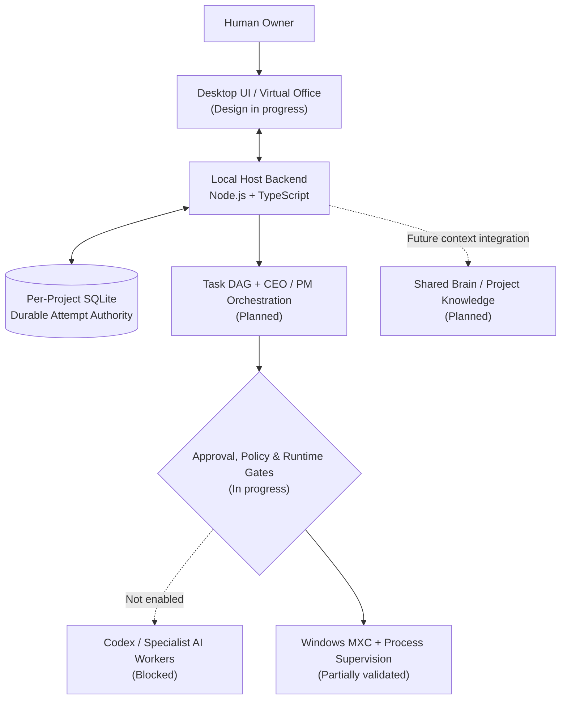

<div align="center">

# AI OFFICE

### A Local-First, Multi-Agent AI Software Development Workspace

**A virtual office where specialized AI agents can plan, collaborate, and eventually execute software development tasks — with the human owner in control.**


**[Overview](#overview) · [Architecture](#system-architecture) · [Development Progress](#development-progress) · [Virtual Office Design](#virtual-office-design) · [Engineering Evidence](#engineering-evidence) · [Roadmap](#roadmap)**

</div>

---

## Overview

**AI OFFICE** is an ongoing independent engineering project exploring how a team of role-based AI agents could coordinate real software development within a visual, desktop-based workspace.

Instead of treating an AI coding tool as an unrestricted command runner, the project focuses on a **host-controlled execution architecture**: persistent task ownership, deterministic state transitions, approval boundaries, sandbox permissions, cancellation, and recovery.

In parallel, the **Virtual Office** design track explores an interactive office experience in which agent activities and project progress will be represented visually.

> **Current scope:** The durable orchestration/security foundation has been implemented and tested in isolated environments. Full multi-agent execution, live provider integration, and real coding workers are **not yet operational**.

### The problem and proposed approach

| Challenge | AI OFFICE approach |
| --- | --- |
| AI tasks can lose context across tools and sessions | Project-scoped state and a planned **Shared Brain** |
| Multiple agents need clear responsibilities | Role-based **CEO, Project Manager, and specialist agents** |
| Concurrent attempts can produce conflicting results | Durable SQLite transactions, ownership generations, and compare-and-swap |
| Cancellation and recovery are difficult to verify | Explicit lifecycle states, audit journal, and fail-closed quarantine |
| AI execution must not bypass user control | Host-owned permissions, sandbox boundaries, and human approval gates |
| Agent activity is difficult to understand | A planned **interactive virtual office** linked to real execution states |

## What I'm building

**1. Orchestration & Backend Security**  
A local backend that can issue and track task attempts, coordinate authorized execution, persist state, reject stale ownership, and recover conservatively from uncertain outcomes.

**2. Interactive Virtual Office**  
A desktop interface that visualizes an AI software team through workspaces, agent roles, activity states, and project dashboards. The visual direction and early workspace concepts are in development; real-time worker-to-visual synchronization is still planned.

**3. Multi-Agent Development Workflow (Target)**  
A structured workflow connecting a CEO/PM layer to specialist agents for frontend, backend, database, QA, security, and DevOps work. Execution will be gated by permissions, evidence, and human approval.

## System Architecture

> Conceptual target architecture. **Solid progress in the persistence layer does not mean the planned integrations below are running.**



**Architectural principle:** the AI model proposes or performs work only within authority granted by the host. A model response is never itself an approval, a durable commit, or proof that an operating-system process has terminated.

## Tech Stack

| Layer | Technology | Current status |
| --- | --- | --- |
| Frontend | **React, Vite** | Existing application architecture; design integration ongoing |
| Backend | **Node.js, TypeScript** | Used in the host-side foundation |
| Persistence | **SQLite (`node:sqlite`)** | Transactional attempt authority tested on isolated databases |
| State consistency | **`BEGIN IMMEDIATE`, CAS, append-only event journal** | Implemented and tested in the foundation |
| Runtime isolation | **Windows MXC** | Bounded filesystem/network sandbox tests completed |
| Process control research | **Win32 Job Objects, disposable C# bridge** | Experimental; current bridge quarantined after failed safety gates |
| AI worker candidate | **Official Codex Windows binary** | Pinned candidate tested in bounded scenarios; real worker blocked |
| Future orchestration | **Deterministic task DAG, LangGraph (candidate)** | Planned, not active |
| Future visual workspace | **Interactive isometric / 3D office** | Concept and early design/prototyping track |
| Future provider layer | **Codex, Gemini, Claude adapters** | Planned; credentials, entitlement, and billing not yet verified |

**Design choices still open:** final desktop shell, production 3D rendering engine, and multi-provider routing implementation. Technologies under evaluation should not be interpreted as already integrated.

## Development Progress

Two tracks are progressing in parallel: **orchestration engineering** and **virtual office design**.

### Track A — Orchestrator & Security Engineering

| Milestone | Delivered outcome | Status |
| --- | --- | --- |
| **S5R2–S8** | Synthetic Windows MXC filesystem restrictions, cooperative child confinement, and loopback network denial tests | **Verified in bounded tests** |
| **S9–S10** | Policy review, synthetic cooperative cancellation, and recovery feasibility | **Completed with limitations** |
| **S11** | Durable ownership, transaction, cancellation, and recovery architecture | **Design accepted** |
| **S12** | SQLite attempt authority, atomic issuance, version/generation CAS, journal consistency | **60 foundation tests passed** |
| **S13–S15** | Durable lease/heartbeat, cancellation authority, recovery classification and quarantine | **135 foundation tests + 127 contract regressions passed** |
| **S16** | Windows process-tree supervision and Job Object analysis | **Conditional — design only** |
| **S16B** | Disposable native bridge and host-only process-control validation | **Blocked — membership/cleanup evidence incomplete** |
| **S16B-R** | Proposed remediation of membership accounting, failure cleanup, and fail-closed test orchestration | **Next / not started** |

**Latest safety decision:** S16B stopped before any MXC experiment. The host-only bridge did **not** prove complete process membership and exit accounting, so it was quarantined. No real coding worker was launched.

### Track B — Virtual Office & Product Design

| Workstream | Progress | Status |
| --- | --- | --- |
| Product concept and AI team roles | Role-based software development office and human approval flow defined | **Concept defined** |
| User experience direction | Project overview, agent roles, and activity-based workspace explored | **Design in progress** |
| Isometric / 3D office concepts | Early visual exploration and workspace prototyping | **In progress** |
| Agent activity animations | Intended states such as planning, working, reviewing, and blocked | **Planned integration** |
| Real-time backend-to-office synchronization | Visuals driven by authoritative task and worker states | **Not yet integrated** |
| Final desktop packaging | Installable standalone Windows experience | **Not finalized** |

<!-- Add real, project-owned screenshots when they are ready and committed to this repository.
Example:

Do not use this path until the image actually exists.
-->

## Engineering Evidence

The project emphasizes **testable guarantees over feature-completion claims**.

| Evidence | Reported result | Interpretation |
| --- | --- | --- |
| S12 isolated foundation | **60 passed, 0 failed** | SQLite authority and transaction behavior |
| S12 existing contract regression | **127 passed** | Relevant legacy contracts remained compatible |
| S13–S15 final foundation suite | **135 passed** | Lease, cancellation, and recovery foundation |
| S13–S15 existing contract regression | **127 passed** | Relevant contracts revalidated |
| S13–S15 combined run | **262 passed, 0 failed/skipped/timed out** | Bounded test result, **not** production readiness |
| S16 process-control audit | **0 runtime launches** | Stopped because independent cleanup prerequisites were missing |
| S16B MXC validation | **0 MXC launches** | Host-only membership and cleanup gates failed first |

The reported test outcomes are recorded in milestone reviews, including:

- [`S13–S15 Pipeline Summary`](docs/reviews/M02-02S13_S15_PIPELINE_SUMMARY.md)
- [`S16 Process-Tree Supervision Report`](docs/reviews/M02-02S16_PROCESS_TREE_SUPERVISION_REPORT.md)
- [`S16B Process-Control Bridge Report`](docs/reviews/M02-02S16B_PROCESS_CONTROL_BRIDGE_REPORT.md)

> Some security evidence uses local, disposable Windows fixtures and is not a public production demo. These test totals come from milestone reports and should be read in that scope.

## Safety & Design Principles

- **Local-first by design:** project state and task authority remain under the local application host.
- **Single authoritative ownership:** durable attempt state is managed transactionally in project-scoped SQLite.
- **Fail closed:** uncertain process identity or lease expiry does not authorize automatic takeover or retry.
- **Explicit human control:** sensitive execution, approvals, and future publishing must pass host-defined gates.
- **Subscription-first strategy:** paid API and purchased-credit fallback remain disabled by policy; provider entitlement and billing safeguards still require validation.
- **No premature worker activation:** real AI coding workers stay blocked until process supervision, output isolation, auth, and integration gates are satisfied.

## Roadmap

- [x] Define local-first product architecture and multi-agent roles.
- [x] Validate bounded sandbox filesystem/network behaviors.
- [x] Design and implement transactional durable attempt authority.
- [x] Validate synthetic lease, cancellation, and recovery behavior.
- [ ] Resolve **S16B-R** process membership, safe cleanup, and fail-closed orchestration.
- [ ] Validate production-grade process supervision and physical output staging/fencing.
- [ ] Integrate the official Codex app-server protocol behind the host security boundary.
- [ ] Verify credential custody, provider entitlement, and included-only billing safeguards.
- [ ] Run full synthetic security/integration E2E validation.
- [ ] Authorize the first tightly scoped **real coding worker pilot**.
- [ ] Connect live agent states to the interactive virtual office and expand multi-agent workflows.

**The roadmap is conditional:** failed security gates may introduce additional work. Milestone numbers represent the engineering sequence, not a delivery-date commitment.

## Repository Guide

The engineering evidence currently centers on these paths:

```text
src/server/attempt-control/                     # Durable attempt contracts and repositories
tests/integration/durable-attempt-foundation/    # Isolated persistence and concurrency tests
docs/reviews/                                    # Security reviews and milestone gate matrices
```

This is an actively evolving development repository, **not a production-ready desktop application**. Setup, build, and runnable demo instructions will be documented after the application/runtime integration is validated. No unverified installation steps are provided here.

## My Role & Learning Focus

**Independent project — system architecture, AI-assisted engineering, security validation, and product design direction.**

This project is an opportunity to practice system design beyond a typical AI chatbot: transactional consistency, process ownership, fault handling, controlled automation, multi-agent architecture, and making an emerging product understandable through UI/UX.

---

<div align="center">

**Building an AI development workspace where autonomy is useful, observable, and accountable.**

*Project status: In Development · Last README progress update: November 2026*

</div>
